# Ardoise

**Ardoise** est une application portable pour Windows qui remplace Wacom Inkspace pour la tablette **Bamboo Slate**, et
qui sait aussi lire la tablette Xiaomi Mijia « petit tableau noir ». Elle récupère les pages écrites sur la tablette,
permet d'écrire en direct à l'écran et au vidéoprojecteur, range les notes dans un dossier de votre choix (par exemple
synchronisé par Nextcloud) et permet de les modifier, de les rejouer, de les exporter et de les imprimer. Tout fonctionne
hors connexion, sans compte, avec un seul fichier : `ardoise.exe`.

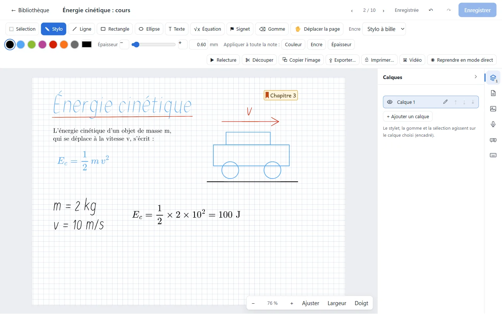

*English summary at the end of this file.*

Les captures de ce fichier montrent la bibliothèque de démonstration d'Ardoise, des notes fabriquées pour l'occasion et
des **tablettes simulées** (voir [Reproduire les captures](#reproduire-les-captures)) : aucune note personnelle.

## Ce que fait Ardoise

### Deux tablettes

<table>
<tr>
<td valign="top">

- **Wacom Bamboo Slate** (le modèle A4 est celui qui a servi aux essais) : enregistrement en Bluetooth LE, une seule fois
  pour tous vos PC, connexion automatique, synchronisation (chaque page devient une note, effacée de la tablette
  seulement quand la note est écrite et relue), informations et réglages de la tablette, quatre positions.
- **Tablette Xiaomi Mijia « petit tableau noir »**, version à mémoire (13,5 pouces) : elle s'ajoute sans enregistrement
  (elle reste liée à Mi Home, qui doit être fermé), ses pages sont importées puis effacées, le mode direct marche comme
  avec la Slate, et ses quatre positions (en hauteur ou en largeur, boutons d'un côté ou de l'autre) se changent même
  pendant le direct.
- Les deux tablettes peuvent être connues en même temps ; Ardoise se connecte à celle qui est allumée.
- Un **test guidé** de la tablette et des journaux détaillés, rangés dans la bibliothèque, permettent de comprendre un
  problème à distance.

</td>
<td valign="top">

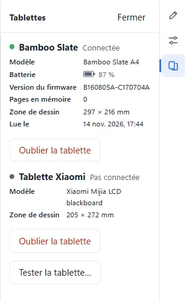

</td>
</tr>
</table>

### Le mode direct et la projection

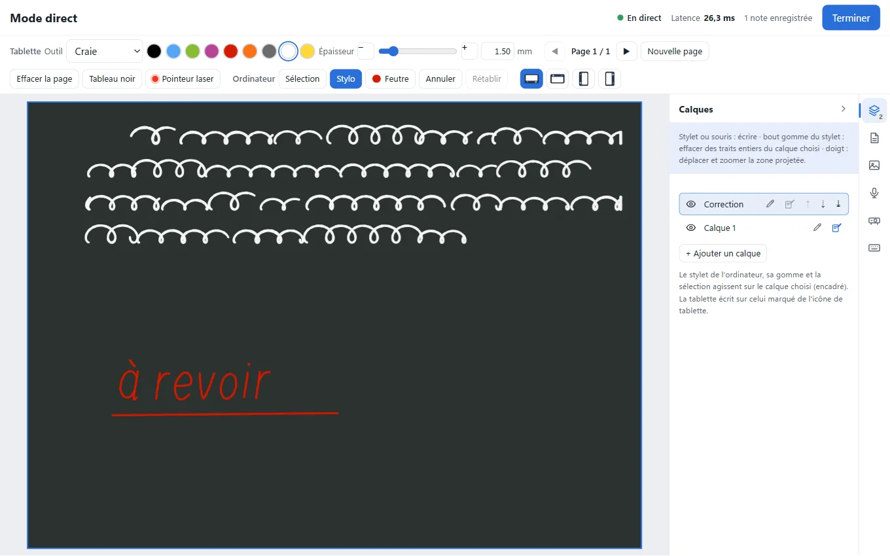

Ce que vous écrivez sur la tablette apparaît aussitôt à l'écran, avec l'encre, la couleur et l'épaisseur choisies ; chaque
page écrite devient une note, enregistrée au fil de l'eau.

- Présentation en plein écran sur un **vidéoprojecteur**, tableau noir, pointeur laser, zoom, annotations par-dessus la
  présentation (jamais enregistrées).
- **Corriger pendant le direct** : l'enseignant écrit en même temps, avec le stylet ou la souris de l'ordinateur, sur un
  calque à lui (rouge par défaut) ; `Ctrl + Z` annule ses gestes, jamais l'écriture de la tablette.
- **Changer le papier** de la page en cours et **poser une fiche** (image ou page de PDF) sous l'écriture, sans arrêter
  la tablette ; **reprendre le direct** sur une feuille déjà enregistrée.
- **Partager sur le réseau** : un autre ordinateur du même réseau affiche la feuille dans un navigateur (adresse, code
  d'accès, rien d'autre que la feuille partagée). Dans l'éditeur, la page de la note ouverte peut aussi être projetée.

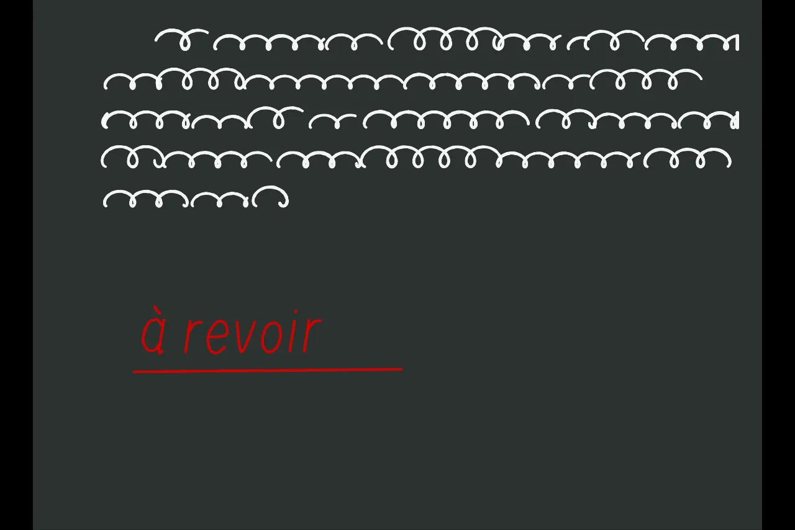

### La bibliothèque

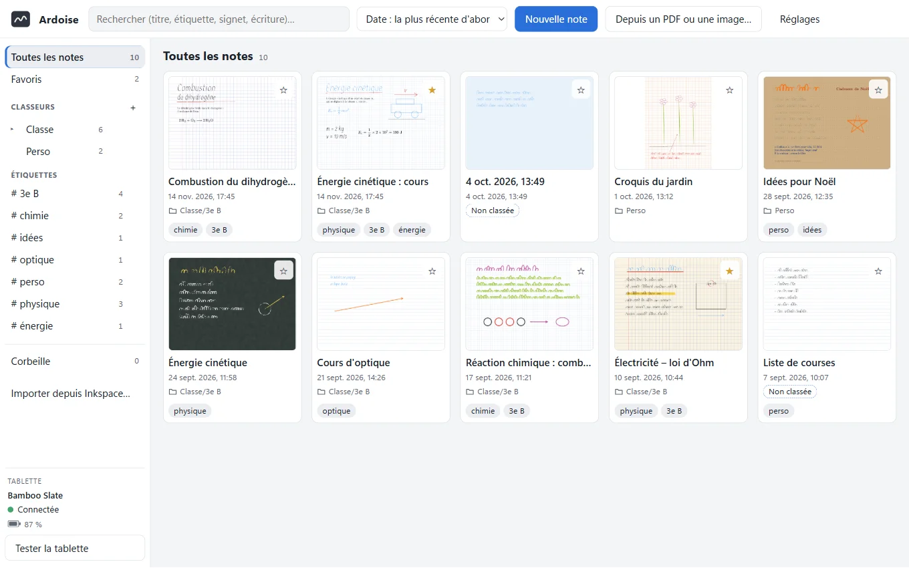

Un dossier ordinaire, une note = un fichier `.ardoise`. Ardoise y écrit toujours de façon atomique et détecte les copies
en conflit, ce qui lui permet de fonctionner avec Nextcloud sur plusieurs ordinateurs.

- **Classeurs** et sous-classeurs (des sous-dossiers), **ordre libre** des notes d'un classeur (glisser-déposer ou
  `Alt` + flèches), **étiquettes** en huit couleurs, **favoris**, corbeille avec « Annuler ».
- **Recherche** dans les titres, les étiquettes, les signets, les textes tapés, le code des équations et l'**écriture
  manuscrite** (reconnaissance d'écriture de Windows, hors connexion).
- Dupliquer une note, **changer sa date**, tourner ou assembler plusieurs notes, créer une note depuis un PDF ou une
  image, menus contextuels au clic droit.
- **Sommaire d'un classeur** : ses sous-classeurs, ses notes et leurs signets, au choix, d'un clic jusqu'à l'endroit voulu
  de la note.

### L'éditeur

- Sept **encres** sensibles à la pression, gomme, lasso, **calques**, papiers et modèles de page (ligné, Seyès, quadrillé,
  millimétré, pointillé, portées), lignes, rectangles et ellipses (qui peuvent s'aimanter au quadrillage), redressement
  des formes, découpe et assemblage de notes, retour à l'original de la tablette.
- **Texte tapé** au clavier, en Latin Modern ou en Andika, au milieu de l'écriture à la main.
- **Équations en LaTeX**, chimie comprise (`\ce{2H2 + O2 -> 2H2O}`, `E_c = \dfrac{1}{2} m v^2`), avec un aperçu qui se
  dessine pendant la frappe, dessinées par Ardoise elle-même dans tous les exports.
- **Signets** (un mot ou une courte phrase posés sur la page) pour le sommaire du classeur, la recherche et le plan du PDF.
- **Image ou PDF de fond** à annoter, choisi sur des miniatures des pages, copier-coller d'une note à l'autre, stylet et
  écran tactile (gomme au dos du stylet, bouton qui lance un lasso). Les modifications non enregistrées sont gardées en
  copie de secours sur le PC et se récupèrent après un plantage.

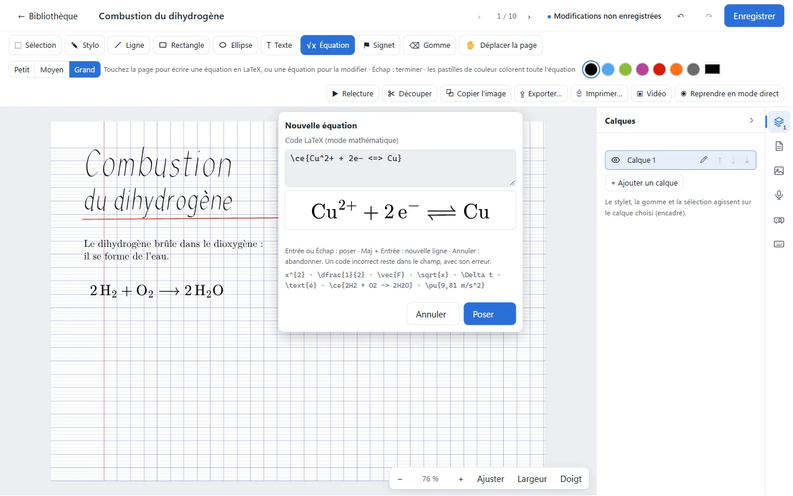

<table>
<tr>
<td valign="top">

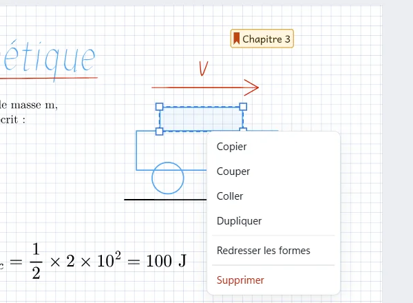

</td>
<td valign="top">

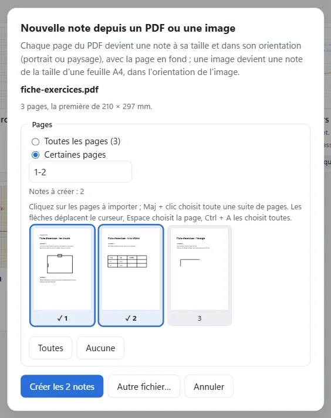

</td>
</tr>
</table>

### La relecture et la vidéo

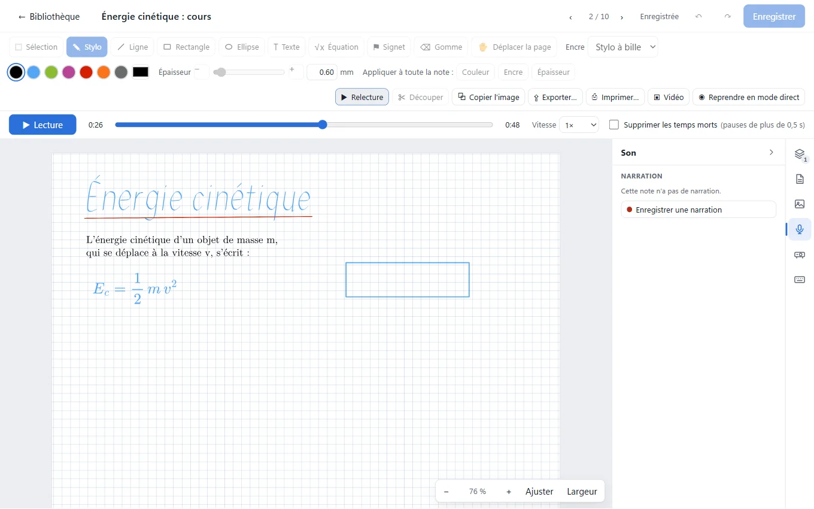

La relecture rejoue le tracé comme il a été écrit (de 0,25× à 16×, temps morts supprimables). On peut y enregistrer une
**narration** au micro, ou l'enregistrer en écrivant ; la note l'emporte avec elle. L'export vidéo produit un **MP4**, un
**WebM**, un **GIF** ou un **WebP** animé.

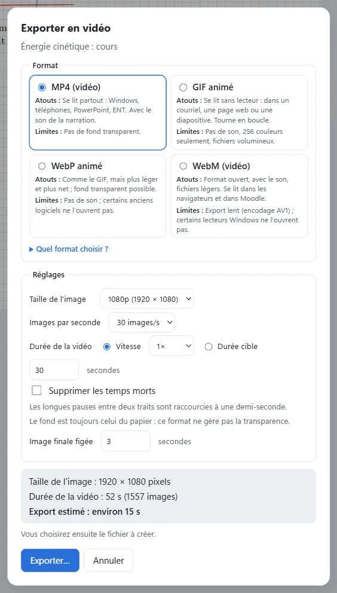

### Les exports et l'impression

- **PNG, JPG, WebP, SVG, PDF** (SVG et PDF peuvent garder les calques séparés), copie dans le presse-papiers, impression
  (1, 2 ou 4 notes par feuille), glisser une note vers l'Explorateur ou Word.
- **Texte, Markdown et Word** à partir de la reconnaissance d'écriture de Windows, avec la structure (titres, listes,
  dessins).
- **Un classeur en un seul PDF**, dans l'ordre du classeur, avec ses signets et, au choix, une **page de sommaire** au
  début (numéros de page, chaque ligne est un lien). Les mêmes trois choix, « Dans le sommaire », règlent le sommaire du
  classeur, le plan du PDF et cette page.

<table>
<tr>
<td valign="top">

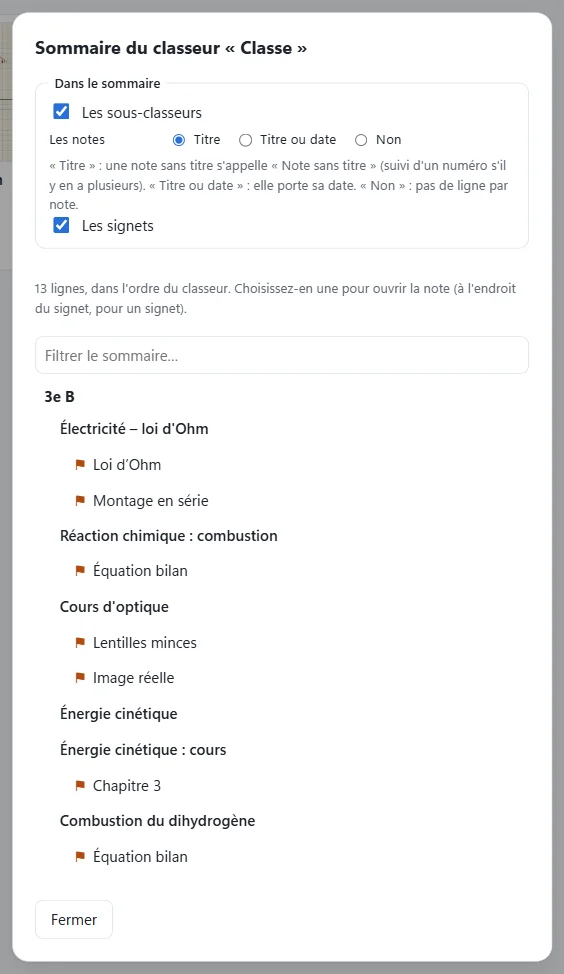

</td>
<td valign="top">

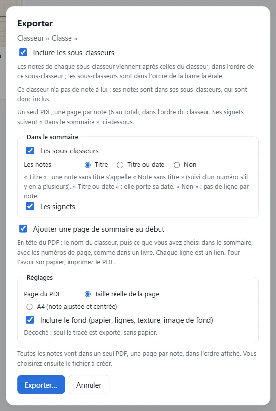

</td>
</tr>
</table>

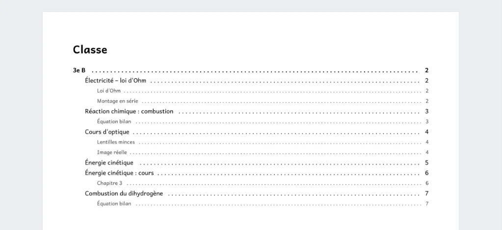

### Autour

- **Import des notes de Wacom Inkspace**, depuis l'application (« Importer depuis Inkspace… ») ou en ligne de commande.
- **Assistant** : un assistant comme Claude Code ou Claude Desktop peut lire, mettre au propre (sur une copie, jamais sur
  l'original) et ranger les notes par le protocole MCP ; Ardoise elle-même ne contient aucune intelligence artificielle.
- Interface en **français et en anglais**, thèmes clair et sombre.

## État du projet

Version 0.1.0 en préparation. Le code est public ; aucune version n'est encore proposée en téléchargement.

- **Bamboo Slate** : essayée à la main par l'auteur, avec une vraie Slate A4 (procédures H1 à H7 de
  [docs/hardware-tests.md](docs/hardware-tests.md), cochées dans la feuille de route) : enregistrement, synchronisation,
  mode direct, vidéoprojecteur, partage sur le réseau, reprise d'une feuille, correction au stylet d'une Surface, papier et
  fiche en direct, son pendant l'écriture. Les captures du protocole prises avec cette tablette servent aux tests. Les
  autres modèles (Slate A5, Spark, Folio, Intuos Pro Paper) ne sont pas essayés.
- **Tablette Xiaomi** : de premiers essais avec la vraie tablette ont eu lieu le 2026-11-13 ; ils ont fait corriger
  plusieurs défauts (import d'une page enregistrée en cours de connexion, effacement de l'écran pendant le direct, copie de
  secours des pages). La procédure complète d'essai (H8) n'est pas terminée, et le mode direct avec la Xiaomi est surtout
  vérifié par une tablette simulée.
- **Le reste** (bibliothèque, édition, relecture, exports, import d'Inkspace) est vérifié sous Windows par des tests
  automatiques sur le vrai exécutable, en français et en anglais. Quelques essais à la main restent à faire : impression sur
  une vraie imprimante, export Word ouvert dans Word, import avec Inkspace ouvert, fermeture de session de Windows avec une
  note non enregistrée.

Voir [les notes de version](docs/notes-de-version.md), [le journal des modifications](CHANGELOG.md) et
[la feuille de route](ROADMAP.md).

## Ce qu'il faut

- Windows 11 (Windows 10 est visé mais n'a pas été essayé), **sans droits d'administrateur**.
- Le moteur d'affichage **WebView2** de Microsoft (présent dans Windows 11).
- Pour une tablette : le **Bluetooth à basse consommation** (Bluetooth 4.0 ou plus), intégré ou par une clé USB. Ardoise
  sert sans tablette : on peut y écrire à la souris, au stylet ou au doigt, annoter un PDF, rejouer et exporter.

## Installation

Ardoise est **portable** : il n'y a pas d'installateur.

1. Décompressez l'archive de distribution `ardoise-<version>-windows-x64.zip` dans un dossier de votre choix (le dossier
   Nextcloud convient). Elle crée un dossier `ardoise-<version>` qui contient :
   - `ardoise.exe` : le programme, seul fichier indispensable ;
   - `LISEZMOI.txt` : l'essentiel, en français et en anglais ;
   - `LICENSE` et `THIRD-PARTY-NOTICES` : la licence d'Ardoise et celles des composants libres qu'elle utilise ;
   - `guide\` : le guide d'utilisation et le guide de l'assistant en pages HTML (`guide.fr.html`, `guide.en.html`,
     `assistant.fr.html`, `assistant.en.html`), à ouvrir dans un navigateur.
2. Lancez `ardoise.exe`. L'exécutable n'est pas signé : Windows peut afficher « Windows a protégé votre ordinateur » ;
   cliquez sur *Informations complémentaires*, puis *Exécuter quand même*.
3. Au premier lancement, choisissez le dossier de la bibliothèque (de préférence un dossier synchronisé).

Les réglages sont dans `ardoise.toml`, à côté de l'exécutable (repli sur `%APPDATA%\Ardoise`). Un second lancement du
même `ardoise.exe` ramène la fenêtre déjà ouverte au premier plan ; deux exemplaires dans deux dossiers fonctionnent côte
à côte.

## Guides

Dans l'archive de distribution, les guides sont les pages HTML du dossier `guide\` ; dans le dépôt, ce sont les
fichiers Markdown suivants.

- [Guide d'utilisation](docs/guide/guide.fr.md) · [User guide](docs/guide/guide.en.md)
- [L'assistant (MCP)](docs/guide/assistant.fr.md) · [The assistant (MCP)](docs/guide/assistant.en.md)
- [Notes de version](docs/notes-de-version.md)
- [Essais sur le matériel réel](docs/hardware-tests.md) (en français)

## Vie privée

Vos notes restent dans votre dossier : pas de compte, pas de nuage. Ardoise n'écoute sur aucun port réseau, sauf pendant
un partage sur le réseau que vous avez lancé vous-même. La seule connexion sortante possible est le téléchargement, à
votre demande, de l'encodeur vidéo de secours OpenH264 chez Cisco. La reconnaissance d'écriture est celle de Windows,
hors connexion. Aucune note personnelle ne figure dans le dépôt.

## Licence et crédits

Ardoise est un logiciel libre, sous licence **GPL-3.0-or-later** (voir [LICENSE](LICENSE)). La liste des composants
tiers et de leurs licences est dans [THIRD-PARTY-NOTICES](THIRD-PARTY-NOTICES).

- **[Tuhi](https://github.com/tuhiproject/tuhi)** (GPL-2.0-or-later) : projet libre qui a documenté le protocole des
  tablettes Wacom ; le protocole d'Ardoise est réécrit à partir de cette documentation et de captures, sans reprendre
  son code.
- **[MathJax](https://www.mathjax.org/)** (Apache 2.0) : la mise en forme des équations LaTeX, fournie avec Ardoise et
  chargée seulement au premier usage de l'outil Équation, sans accès au réseau.
- **Latin Modern** (GUST, licence GUST Font License) et **Andika** (SIL International, SIL Open Font License 1.1) : les
  deux polices du texte tapé, fournies avec Ardoise.
- **OpenH264** (Cisco Systems, Inc.) : « OpenH264 Video Codec provided by Cisco Systems, Inc. ». Il n'est **jamais
  fourni** avec Ardoise : l'utilisateur le télécharge chez Cisco, seulement s'il en a besoin (MP4 sans l'encodeur de
  Windows).

## Développement

Les consignes de travail du projet sont dans [CLAUDE.md](CLAUDE.md) ; le cahier des charges est
[SPEC.md](SPEC.md) et la feuille de route [ROADMAP.md](ROADMAP.md). Les documents de conception (en anglais) sont dans
[docs/design/](docs/design/).

**Prérequis de compilation (Windows)**

- La chaîne d'outils **Rust** (stable, édition 2024, 1.90 au minimum) avec la cible `wasm32-unknown-unknown`
  (`rustup target add wasm32-unknown-unknown`) : le calcul des contours des traits est compilé en WebAssembly pour
  l'écran.
- **Node.js** 24 et npm (interface Svelte 5 + TypeScript).
- **nasm** (assembleur de l'encodeur AV1 `rav1e`, pour le WebM) : sous Windows, le zip portable décompressé dans
  `%LOCALAPPDATA%\ArdoiseDev\nasm-<version>\` est trouvé par `cargo xtask` ; pour une commande `cargo` directe, définir la
  variable `NASM`. Jamais nécessaire chez l'utilisateur.

**Commandes**

| Commande | Rôle |
|---|---|
| `cargo fmt --all` | Formatage, avant la vérification |
| `cargo xtask check` | Vérification complète (dépendances npm, interface, formatage, clippy sans avertissement, tests Rust, `svelte-check` et vitest, compilation release) ; se termine par `CHECK OK`. `--quick` saute la compilation release |
| `cargo xtask selftest` | Taille de `target\release\ardoise.exe` (moins de 40 Mo) puis `ardoise.exe --self-test` ; se termine par `SELFTEST OK` |
| `cargo xtask e2e` | Parcours de bout en bout sur l'exécutable de production (fenêtre pilotée par le port de débogage de WebView2), en français et en anglais ; se termine par `E2E OK` (lancer `check` avant) |
| `cargo xtask perf [--write]` | Mesure les objectifs de performance (SPEC §8) sur l'exécutable de production ; `--write` met à jour `docs/performance.md` |
| `cargo xtask licenses [--write]` | Vérifie la licence de chaque dépendance (liste blanche compatible GPL v3, aucune AGPL) et que `THIRD-PARTY-NOTICES` est à jour ; `--write` le régénère |
| `cargo xtask privacy` | Parcourt tout l'historique git à la recherche de données personnelles ; se termine par `PRIVACY OK` |
| `cargo xtask dist [--reuse]` | Fabrique l'archive de distribution `target\dist\ardoise-<version>-windows-x64.zip` : un dossier `ardoise-<version>` avec `ardoise.exe`, `LICENSE`, `THIRD-PARTY-NOTICES`, `LISEZMOI.txt` et `guide\*.html` (les guides de `docs/guide/`, convertis en HTML, liens entre pages compris) ; ne publie rien |
| `node app/e2e/screenshots.mjs <ardoise.exe> docs/guide/images/fr --lang fr` | Reprend les captures de ce fichier (voir ci-dessous) ; ne fait pas partie de `cargo xtask e2e` |

Une compilation release de l'application exige `--features custom-protocol` (sinon Tauri chargerait l'interface depuis le
serveur de développement) ; `cargo xtask check` s'en charge. Interface seule (dans `app/`) : `npm run build`,
`npm run check`, `npm test` ; application en développement : `npm run tauri dev`. Chaque crate se teste séparément :
`cargo test -p ardoise-core`.

Options de l'exécutable utiles au développement : `--self-test`, `--diagnostic [--simulated]`, `--simulated-tablet`,
`--simulated-blackboard`, `--simulated-microphone`, `--create-demo-library DOSSIER [--demo-notes N]`,
`--import-inkspace`, `--create-demo-inkspace DOSSIER`, `--import-blackboard-pages DOSSIER`, `--mcp [--read-only]`.

### Reproduire les captures

Les images de `docs/guide/images/fr/` sont prises sur l'exécutable de production par `app/e2e/screenshots.mjs`, qui utilise le même
banc que les parcours de bout en bout : une copie portable de l'exécutable, une bibliothèque de démonstration dans un
dossier temporaire (jamais la vraie bibliothèque ni le vrai `ardoise.toml`), les deux tablettes simulées, des notes
écrites avec des événements de stylet, un PDF fabriqué par le script. Aucune boîte de dialogue du système n'est ouverte et
le micro n'est jamais allumé. Il s'ouvre quelques fenêtres d'Ardoise sur le PC, dont une fenêtre de projection en plein
écran pendant quelques secondes.

```
cargo xtask check
node app/e2e/screenshots.mjs target\release\ardoise.exe docs/guide/images/fr --lang fr
node app/e2e/screenshots.mjs target\release\ardoise.exe docs/guide/images/en --lang en
node app/e2e/screenshots.mjs target\release\ardoise.exe docs/guide/images/fr --lang fr --only editor,equation
```

---

## English summary

**Ardoise** is a portable Windows application (Rust + Tauri 2) that replaces Wacom Inkspace for the **Bamboo Slate**
tablet, and also reads the Xiaomi Mijia LCD blackboard (13.5", the model with memory). It receives the pages written on
the tablet over Bluetooth LE, lets you write live on screen and on a projector, keeps your notes as plain files in a
folder of your choice (typically synced by Nextcloud), and lets you edit, replay, export and print them. The interface
is in French and English. The pictures below show the demo library and simulated tablets.


- **Live mode**: what the tablet writes shows on screen at once, full-screen projection, blackboard, laser pointer,
  and a teacher's own layer to correct while a pupil writes. Paper and a PDF worksheet can be changed under the page; the
  live sheet can be shared with a browser on the same network.


- **Library and editor**: binders, free order, coloured tags, favourites, search (titles, tags, bookmarks, typed text,
  handwriting through Windows' offline recognition); seven pressure-sensitive inks, layers, shapes, typed text (Latin
  Modern or Andika), LaTeX equations with chemistry (MathJax), bookmarks, PDF or image backgrounds, replay and narration.
- **Exports**: PNG, JPG, WebP, SVG, PDF (layers kept apart on request), text, Markdown, Word, MP4, GIF, WebP, WebM,
  clipboard, printing; a whole binder in one PDF with its outline and an optional summary page. It can import Inkspace
  notes and can be driven by an assistant such as Claude Code or Claude Desktop through MCP.


- **Status**: version 0.1.0 in preparation; the source is public; no release is offered for download yet. The
  author tried the Bamboo Slate by hand with a real Slate A4 (registration, sync, live mode, the projector, network
  sharing, resuming a sheet, correcting with a pen). The Xiaomi tablet has had its first trials with the real device
  (several faults fixed); its full test procedure is not finished and its live mode is mostly checked with a simulated
  tablet. Everything else is
  checked on Windows by automated tests on the production executable, in French and English; a few hands-on checks remain
  (printing on a real printer, Word export opened in Word, Inkspace import with Inkspace open, a real Windows logoff).
- **Requirements**: Windows 11 (Windows 10 not tried), WebView2, and Bluetooth LE for a tablet. No administrator rights.
- **Installation**: unzip the portable archive `ardoise-<version>-windows-x64.zip` anywhere; the `ardoise-<version>`
  folder holds `ardoise.exe` (the only essential file), `LICENSE`, `THIRD-PARTY-NOTICES`, `LISEZMOI.txt` and the guides
  as HTML pages in `guide\`. Run `ardoise.exe` (unsigned: Windows SmartScreen may show a warning, choose *More info* then
  *Run anyway*). Settings are kept in `ardoise.toml` next to the executable.
- **Guides**: [user guide](docs/guide/guide.en.md), [assistant guide](docs/guide/assistant.en.md), [release
  notes](docs/notes-de-version.md) (French, with an English section). In the archive, the guides are the HTML pages of
  the `guide\` folder.
- **Privacy**: no account, no cloud, no listening network port except during a network share you start yourself; the
  only possible outgoing connection is the optional download of the OpenH264 encoder from Cisco. No personal notes are
  in the repository.
- **Licence**: GPL-3.0-or-later. Credits: the [Tuhi](https://github.com/tuhiproject/tuhi) project for its documentation
  of the Wacom protocol; MathJax (Apache 2.0); the Latin Modern (GUST Font License) and Andika (SIL OFL 1.1) fonts;
  OpenH264 by Cisco Systems, Inc., downloaded by the user and never shipped with Ardoise.
- **Development**: Rust (stable, 1.90 or later) with the `wasm32-unknown-unknown` target, Node.js 24, and `nasm`
  (portable zip under `%LOCALAPPDATA%\ArdoiseDev`). Run `cargo xtask check` (ends with `CHECK OK`), then
  `cargo xtask selftest` and `cargo xtask e2e`; also `cargo xtask licenses`, `cargo xtask privacy`, `cargo xtask perf`
  (performance measurements) and `cargo xtask dist` (distribution archive). The pictures of this file are taken by
  `node app/e2e/screenshots.mjs <ardoise.exe> docs/guide/images/fr --lang fr`. See [CLAUDE.md](CLAUDE.md).
