# Ardoise user guide

Ardoise is a Windows application that replaces Wacom Inkspace for the *Bamboo Slate* tablet. It receives over
Bluetooth the pages you write on the tablet, lets you write live on screen (and on a projector, in class), keeps your
notes in a folder of your choice, and lets you edit, replay and export them. It also reads the *Xiaomi Mijia "small
blackboard"* tablet (memory edition).

This guide follows the order in which you meet things. The names of buttons and menus are written in bold, as they
appear on screen. If you are new to Ardoise, start with **Getting started**: a short thread from the first start to a
first exported note, which points to the detailed chapters. Version française : [guide.fr.md](guide.fr.md).

> *Where does this version stand?* No version has been published yet. The A4 *Bamboo Slate* has been tried by hand by
> the author: registration, sync, live mode, projector, sharing on the network, resuming a sheet, correcting with a
> Surface's pen, paper and sheet in live mode, projecting the editor, sound while writing. The *Xiaomi* tablet had its
> first real trials on 13 November 2026, which led to several defects being fixed; the full trial procedure is not
> finished, and its live mode is mostly checked with a simulated tablet. Everything else (library, editing, replay,
> exports, import of Inkspace notes) is checked on Windows by automated tests on the real program. Still to be tried by
> hand: printing on a real printer, a Word export opened in Word, an import with Inkspace open, a Windows logoff with an
> unsaved note. The passages that only work with a tablet carry the mention "*Needs the tablet*". See also the release
> notes.

## Contents

- [Getting started](#getting-started)
- [1. What Ardoise is](#1-what-ardoise-is)
- [2. Installing Ardoise](#2-installing-ardoise)
- [3. First start](#3-first-start)
- [4. Registering the tablet (and adding the Xiaomi tablet)](#4-registering-the-tablet)
- [5. Getting your pages: sync](#5-getting-your-pages-sync)
- [6. Live mode and presenting in class](#6-live-mode-and-presenting-in-class)
- [7. The library](#7-the-library)
- [8. Editing a note](#8-editing-a-note)
- [9. Replay, narration and video](#9-replay-narration-and-video)
- [10. Exporting, printing, sharing](#10-exporting-printing-sharing)
- [11. Importing your Inkspace notes](#11-importing-your-inkspace-notes)
- [12. Pen and touch screen](#12-pen-and-touch-screen)
- [13. Diagnostics and trials with the tablet](#13-diagnostics-and-trials-with-the-tablet)
- [14. The assistant (Claude Code, Claude Desktop)](#14-the-assistant-claude-code-claude-desktop)
- [15. Privacy](#15-privacy)
- [16. When something goes wrong](#16-when-something-goes-wrong)
- [17. Keyboard shortcuts](#17-keyboard-shortcuts)

---

## Getting started

This thread goes from the first start to a first exported note. Each step points to the chapter that gives the details.
The screenshots show the program with demonstration notes and a simulated tablet.

1. **Unzip and start.** Right-click the archive `ardoise-<version>-windows-x64.zip`, *Extract all…*, then double-click
   `ardoise.exe` in the resulting folder. There is nothing to install. Windows may show a blue "*Windows protected your
   PC*" screen: *More info*, then *Run anyway* (chapter [2](#2-installing-ardoise)).

2. **Choose the folder for your notes.** At the first start, the **Welcome to Ardoise** window asks where to keep the
   library. Click **Choose a folder…**, preferably a synced folder (Nextcloud, OneDrive…), then **Continue** (chapter
   [3](#3-first-start)). The language is changed at the bottom of the same window.

   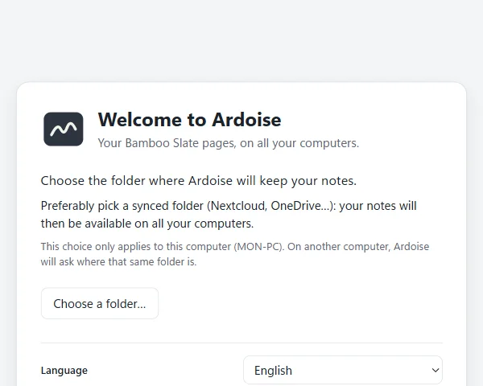

3. **Discover the library.** It is the home page: on the left, **All notes**, **Favourites**, the **Binders**, the
   **Tags**, the **Trash** and the **Tablet** block; in the middle, one card per note. A click on a card opens the note
   (chapter [7](#7-the-library)).

   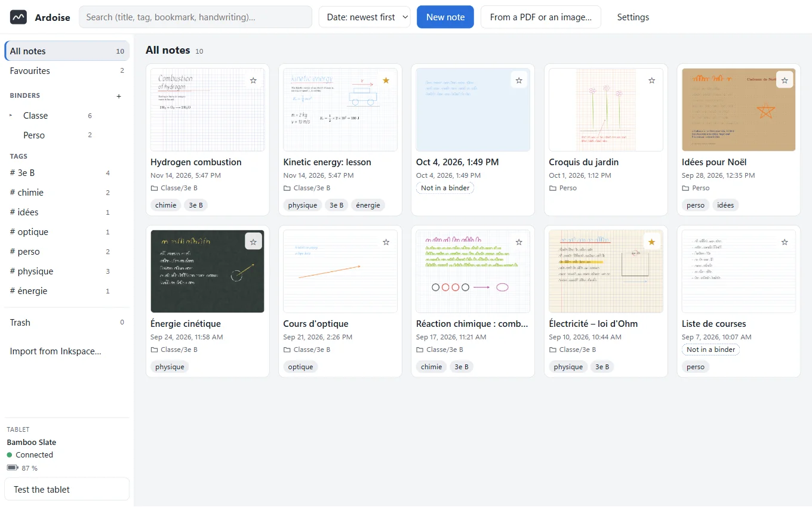

4. **With a tablet: register it.** Click the **Tablet** block of the sidebar, then **Register the Bamboo Slate** (for the
   Xiaomi tablet, **Add the Xiaomi tablet**). Read the **Before you start** warning, click **Continue**, then follow the
   assistant: hold the tablet's button for about 6 seconds, then press it briefly to confirm (chapter
   [4](#4-registering-the-tablet)). *Without a tablet, go to step 6.*

   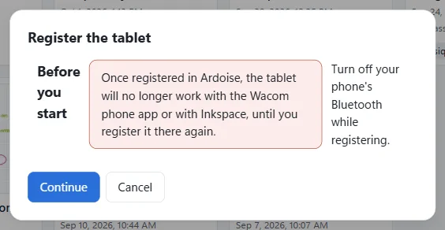

5. **With a tablet: get its pages.** Write a page on the tablet, then press its button briefly to save it in its memory.
   In the **Tablet** panel, **Use** tab, click **Sync**: each page becomes a note in the library. **Live mode**, on the
   other hand, shows what you write on the tablet as you write it, on screen and on the projector (chapters
   [5](#5-getting-your-pages-sync) and [6](#6-live-mode-and-presenting-in-class)).

   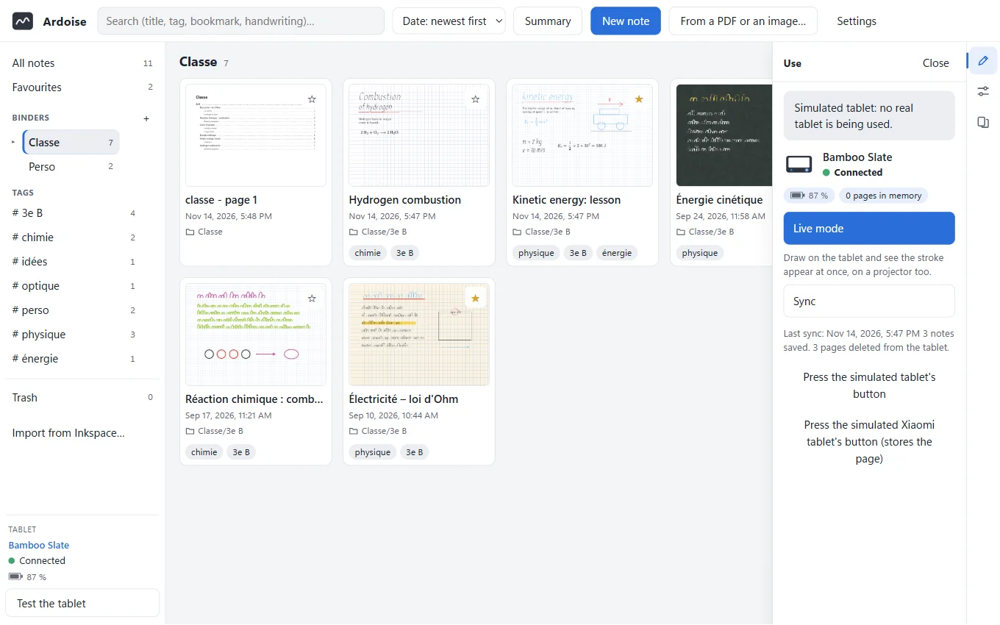

6. **Without a tablet: create a note.** Click **New note** (or `Ctrl + N`): a blank landscape A4 page opens in the
   editor. To annotate an existing document, **From a PDF or an image…** (chapter [7](#7-the-library)).

7. **Write.** With the **Pen** tool, write with the mouse or the pen; a finger scrolls the page, unless you tick
   **Finger** (chapter [12](#12-pen-and-touch-screen)). Choose the **Ink**, the **Colour** and the **Width** in the
   toolbar; **Eraser**, **Select**, **Line**, **Rectangle** and **Ellipse** are next to them (chapter
   [8](#8-editing-a-note)).

   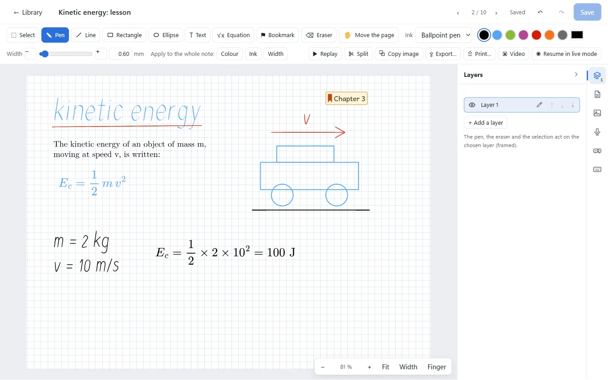

8. **Add typed text.** Choose the **Text** tool (`T` key), click where you want it, type; `Esc` ends the entry. The
   **Latin Modern** and **Andika** buttons, **Small**, **Medium**, **Large** and **Bold** set the text (see "Typing
   text", chapter [8](#8-editing-a-note)).

   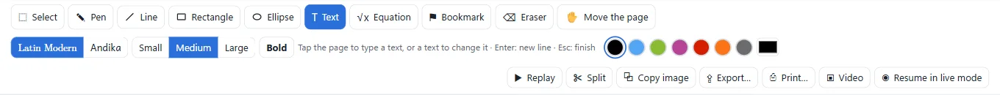

9. **Add an equation.** Choose the **Equation** tool (`M` key), click the page, type the code in **LaTeX code** (for
   example `E_c = \dfrac{1}{2} m v^2`), check the preview, then click **Place** (see "Writing an equation", chapter
   [8](#8-editing-a-note)).

   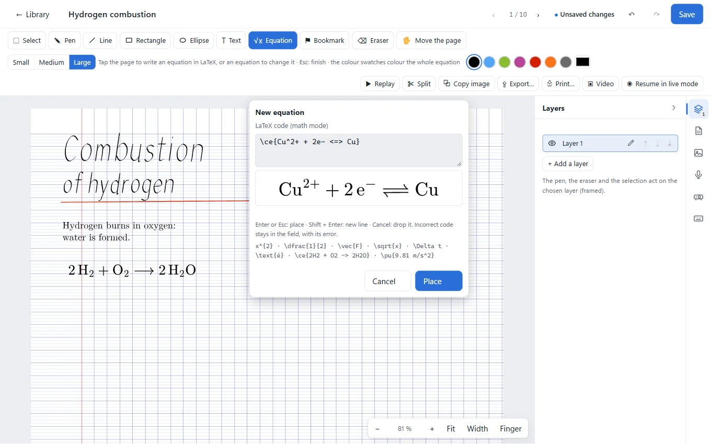

10. **Place a bookmark.** The **Bookmark** tool (`B` key) places a word or a short phrase ("Chapter 3") on the page: it
    will be used by the binder's summary and by search (see "Putting bookmarks", chapter [8](#8-editing-a-note)).

11. **Save.** Nothing is saved until you click **Save** (`Ctrl + S`): the state **Unsaved changes** becomes **Saved**.
    If you like, give the note a title in the **Title of the note** field (chapter [8](#8-editing-a-note)).

12. **Export as PDF.** Click **Export…** in the toolbar, choose **PDF**, set the page if needed (**The page's actual
    size** or **A4**), click **Export…** and say which file to create. To print, **Print…** or `Ctrl + P` (chapter
    [10](#10-exporting-printing-sharing)).

    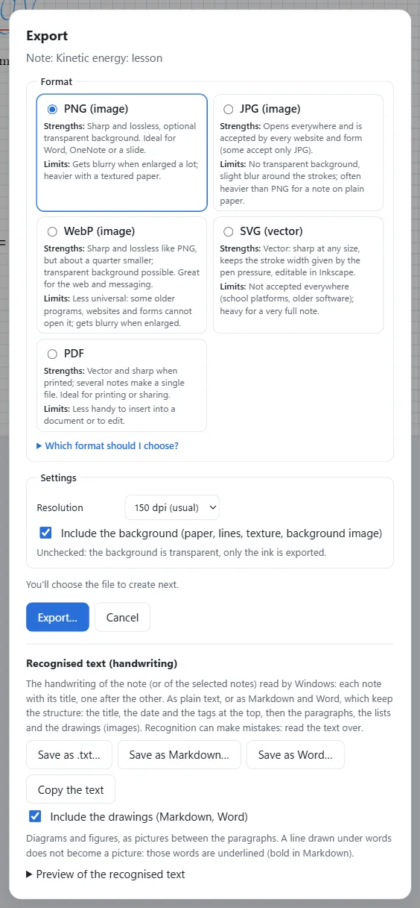

13. **Find the note again.** Go back to the library (**Library**, or `Esc`, which saves and goes back) and type a few
    letters in **Search notes** (`Ctrl + F`): Ardoise searches the titles, the tags, the bookmarks, the typed texts and
    the handwriting (chapter [7](#7-the-library)).

    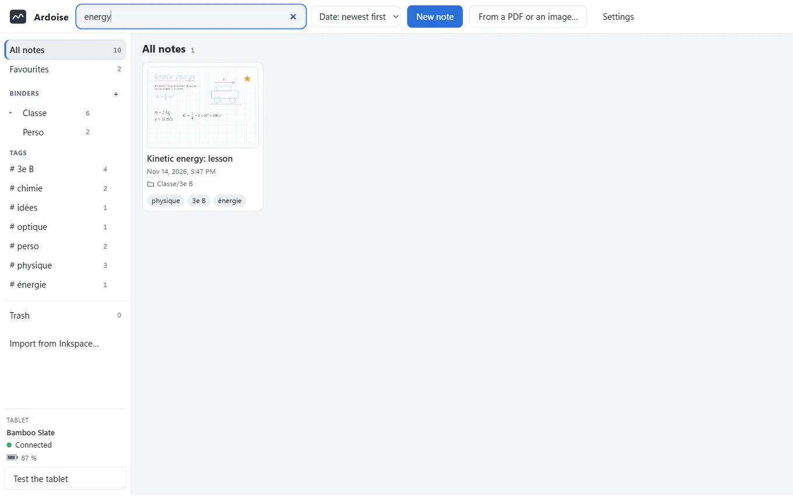

To go further: put a lesson on video (chapter [9](#9-replay-narration-and-video)), project the class (chapter
[6](#6-live-mode-and-presenting-in-class)), import your Inkspace notes (chapter [11](#11-importing-your-inkspace-notes)).

---

## 1. What Ardoise is

- *With or without a tablet*: Ardoise receives the pages of a Bamboo Slate or of a Xiaomi tablet, but it also works on
  its own. On a pen or touch-screen computer (Surface Pro, Yoga, 2-in-1 PCs) it is a note-taking application: **New
  note**, and you write straight on the screen (chapter 12). A mouse is enough to annotate a PDF or draw shapes.
- *Portable*: a single file, `ardoise.exe`, that you copy wherever you like, a Nextcloud folder included. No installer,
  no administrator rights, nothing in `Program Files`.
- *No account, no cloud*: your notes are files in a folder you choose. Ardoise connects to no server (its only
  possible connection is the optional download of a backup video encoder, see chapter 9). It contains no artificial
  intelligence and works offline.
- *One folder, several computers*: if that folder is synced by Nextcloud, OneDrive or similar, you find your notes, and
  even the tablet's registration, on all your PCs.
- *One note = one file* `.ardoise`, kept in subfolders that are your binders.
- The interface is in *English and French*, with light and dark themes.

*What needs the tablet*: registering the tablet, syncing it, live mode (and so projecting the live mode), the tablet
test. *Everything else works without it*, including creating notes with the mouse, the pen or a finger, annotating a
PDF, replaying, exporting.

*What Ardoise does not do*: Wacom's cloud and Inkspace's real-time collaboration, macOS and Linux, phone apps. A note
is handwriting, but also clean shapes, text typed on the keyboard, LaTeX equations (chemistry included) and
bookmarks: see chapter 8.

## 2. Installing Ardoise

### What you need

- Windows 11 (Windows 10 has not been tried). Microsoft's *WebView2* display engine must be present: it is part of
  Windows 11.
- For the tablet: Bluetooth Low Energy (Bluetooth 4.0 or later), built into the PC or through a small USB dongle. No
  prior setup in the Windows Bluetooth settings is needed: the tablet is registered inside Ardoise (chapter 4).

### Installing = unzipping

Ardoise comes as an archive `ardoise-<version>-windows-x64.zip` (for example `ardoise-0.1.0-windows-x64.zip`).

1. If the archive came from a download or an email, first right-click it, choose *Properties*, and tick *Unblock* if it
   is offered.
2. Right-click the archive, choose *Extract all…*, and pick the folder where the program will live, for example
   `C:\Users\Name\Nextcloud\Ardoise\Program` (Windows suggests a folder named after the archive: you can shorten it).
   The content arrives in a folder `ardoise-<version>`.
3. In that folder, double-click `ardoise.exe`. Create a desktop shortcut if you want.

The folder contains:

- `ardoise.exe`: the program. It is the only essential file; there is nothing to install;
- `LISEZMOI.txt`: the essentials in French and English;
- `LICENSE` and `THIRD-PARTY-NOTICES`: Ardoise's licence (GNU GPL version 3) and those of the free components it uses;
- `guide\`: this guide and the assistant guide, as HTML pages to open in a web browser (double-click them):
  `guide.fr.html`, `guide.en.html`, `assistant.fr.html` and `assistant.en.html`. The links from one page to the other
  work.

**Opening this guide from Ardoise.** The **Guide** button in the library's top bar, the first block of the **Help** tab of
the editor and of live mode, and the `F1` key open this guide in your browser, offline, from the `guide` folder next to
`ardoise.exe`. If that folder is missing (you only kept `ardoise.exe`), the same guide opens on GitHub, and Ardoise
tells you so: it is then a page on the Internet.

To uninstall, delete that folder (and, if you like, `%LOCALAPPDATA%\Ardoise`, see below). Your notes are not touched:
they are in your library.

### Windows' warning at the first start

The executable is not digitally signed. Windows may therefore show a blue "*Windows protected your PC*" screen: click
*More info*, then *Run anyway*. This is normal for an unsigned program. If the file came from a download or an
email, also right-click `ardoise.exe`, choose *Properties*, and tick *Unblock* if it is offered.

On a PC managed by an IT department, Windows (Smart App Control, AppLocker…) may refuse without offering to carry on.
Ardoise cannot do anything about it: ask your IT department for permission.

### The settings file

Your settings are in `ardoise.toml`, *next to `ardoise.exe`*: the file travels with the program. If that folder is
not writable, Ardoise uses `%APPDATA%\Ardoise\ardoise.toml`. The exact path is shown at the bottom of **Settings**.
The file is plain text, but you never need to edit it by hand.

### Starting Ardoise twice

Only one Ardoise window is open per copy of the program: if you double-click the same `ardoise.exe` again (one
double-click too many during a slow start, for example), Ardoise brings the window that is already open to the front
instead of opening a second one, which would fight over the tablet. Two copies placed in *two different folders* (so
with two `ardoise.toml` files) can, on the other hand, run side by side. The commands written in this guide
(`--self-test`, `--import-inkspace`, `--create-demo-library`…) work even while the Ardoise window is open.

### Several computers

- Put `ardoise.exe` (and so `ardoise.toml`) in a synced folder, for example Nextcloud. Since the path of the library
  folder is not the same on every PC, Ardoise keeps that setting *per computer name* in `ardoise.toml`, for example:

  ```toml
  [machines."HOME-PC"]
  library = 'C:\Users\Name\Nextcloud\Ardoise\Notes'

  [machines."WORK-PC"]
  library = 'D:\Nextcloud\Ardoise\Notes'
  ```

- At the first start on a new PC, Ardoise asks where the library is (chapter 3); you do not have to touch the file.
- The tablet's registration is in the library (`_ardoise\device.json`): *registering the tablet once is enough* for all
  your PCs.
- *Do not edit the same note on two PCs at the same time.* If it happens, Ardoise refuses to overwrite the other version
  and offers to save yours as a copy (chapter 8). The "conflict copies" created by Nextcloud are flagged in the library
  (chapter 7).
- *Updating*: close Ardoise on all PCs, then replace `ardoise.exe`. An executable started from Nextcloud is locked while
  it runs, so the sync of the new version would fail. A recent version reads all older notes; if a note was made by a
  version newer than yours, Ardoise asks you to update.

### What Ardoise keeps on each PC

These folders belong to each computer and are never in your library or in Nextcloud, under `%LOCALAPPDATA%\Ardoise`:
WebView2's folder (`webview`), the thumbnails (`thumbnails`), the recognised text used by search (`handwriting`), the
OpenH264 encoder if you downloaded it (`codecs`), and three folders of *backup copies* (`drafts` for the changes of a
note not saved yet, see chapter 8, `live-backup` for live pages that could not be written, `narration-backup` for a
narration that could not be added to its note). WebView2's folder, the thumbnails and the recognised text rebuild
themselves; delete the backup copies only after making sure you no longer need them.

## 3. First start

At the first start on a PC, the **Welcome to Ardoise** window asks for the folder where your notes will be kept (the
**Language** of the interface is chosen at the bottom of the same window).


1. Click **Choose a folder…** and preferably pick a synced folder (Nextcloud…), for example
   `C:\Users\Name\Nextcloud\Ardoise\Notes`.
2. Ardoise tells you whether it already contains a library ("it will be used as is") or whether it will create a new
   one. This choice only applies to this computer.
3. If Ardoise finds Wacom Inkspace notes on this PC, the window says so ("Ardoise found Wacom Inkspace notes on this
   computer (24 notes).") and offers a box, ticked by default: **Import them into the library (binder “Inkspace”)**.
   Untick it if you do not want to import them now; you can do it later (chapter 11).
4. Click **Continue**. If the Inkspace box is ticked, the import window opens straight away in the library: you confirm
   the import before it starts (chapter 11).

You arrive in the *library*. While it is empty, it says that the pages from your tablet will appear after the first
sync; you can already create a note with **New note**. Ardoise creates a `_ardoise` folder in the library (tablet
registration, diagnostic logs, trash, tag colours). It is not hidden, so that Nextcloud syncs it: leave it alone.

To change library later: **Settings**, then **Change** next to **Library folder**, and pick the folder. Ardoise does
not switch straight away: it first shows what that folder holds ("This folder already contains an Ardoise library: it
will be used as is" or "A new library will be created in this folder", and the number of notes), reminds you that the
change only applies to this PC, and waits for your agreement: **Use this folder** (or **Cancel**). The notes of the old
library stay in their folder.

The general settings are also in **Settings**: **Language** (**Automatic (Windows language)**, **Français** or
**English**) and **Theme** (**Same as Windows**, **Light**, **Dark**).

*Trying it without a tablet.* To discover Ardoise without touching your own notes, you can create a demonstration
library (invented notes). In PowerShell, in the folder of `ardoise.exe`:

```
.\ardoise.exe --create-demo-library C:\Users\Name\Ardoise-Demo
```

then choose that folder as your library. And to try sync and live mode without a tablet, start
`.\ardoise.exe --simulated-tablet`: a *simulated tablet* (three pages in memory) replaces Bluetooth; it is never mixed
up with the real tablet's registration. `--simulated-blackboard` does the same with a simulated Xiaomi tablet (three
pages in memory), alone or together with the first one. One note of the demonstration library, "Cours d'optique", is handwritten
(synthetic glyphs) and lets you try the handwriting search.

## 4. Registering the tablet

*Needs the tablet.* Registration is done once.

> *Before you start*: a Bamboo Slate is registered with only one application at a time. Once registered in Ardoise, it
> no longer works with the Wacom phone app or with Inkspace, until you register it there again. Turn off your phone's
> Bluetooth during the registration.

1. Charge the tablet and keep it near the computer; Bluetooth must be on, on the PC.
2. In the sidebar, at the bottom, click the **Tablet** block (it shows **No tablet registered**), then
   **Register the Bamboo Slate** (in the **Tablets** tab, under **Add a tablet**, when another tablet is already known).
3. Read the warning (**Before you start**) and click **Continue**.

   

4. Follow the assistant, which shows a drawing of the tablet:
   - **Hold the tablet's button** down for about 6 seconds, until the light blinks blue;
   - **Looking for the tablet**, then **Connecting to the tablet**: stay still, it can take a few seconds;
   - **Press the button briefly** to confirm (you have about 30 seconds);
   - **Tablet registered**: the tablet's name appears. Click **Done**.
5. If the registration fails, Ardoise writes what went wrong; check Bluetooth, the charge and the distance, then
   click **Try again**. **Cancel** is available at every step.

The **Tablet** panel is narrow: three tabs, icons on a rail at the right (the up and down arrows move between them,
`Enter` opens the one that has the focus), and nothing to scroll.

- **Use**: the connected tablet (its picture, name, state, battery and number of pages in memory), then **Live mode** and
  **Sync**, which says how many pages wait ("3 pages"). A badge on the icon gives the same number, even while another
  tab is open. Below: the result of the last sync and what Ardoise says about the state (looking for the tablet, pages
  that wait, a failure…).
- **Settings**: those of *one* tablet at a time. When you know two, a list chooses which (the connected tablet to begin
  with). See "The options", below.
- **Tablets**: the known tablets, with what they reported at their last connection (model, battery, firmware version or
  free memory, number of pages in memory, drawing area, date read), **Forget the tablet** for each, **Add a tablet** and
  **Test the tablet…**. This information is read at the first connection.

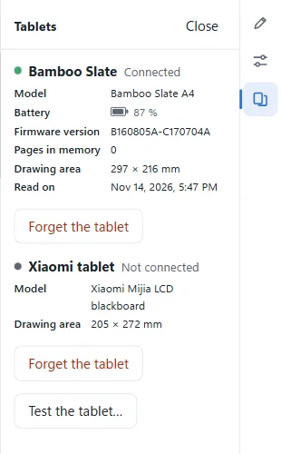

The tablet is then recognised on *all* your PCs that use the same library. To undo this: **Settings**, **Tablet**
section (or the panel's **Tablets** tab), **Forget the tablet** (it will have to be registered again, on all your
computers). If you also have a Xiaomi
tablet (below), each one has its own button.

In the **Settings** tab of the **Tablet** panel, for the Bamboo Slate, you can **Rename** the tablet (1 to 15
characters, no accents) and **Set the clock** (the tablet's clock is set to the PC's).

### Adding the Xiaomi tablet

*Needs the Xiaomi tablet.* Ardoise also reads the **Xiaomi Mijia "small blackboard", memory edition** (13.5 inches,
Bluetooth; model `jiqid.sxb.v1` in Mi Home). It is added next to the Bamboo Slate, without any registration.

> *Before you start*: the Xiaomi tablet talks to **one application at a time**. Close Mi Home, or turn off your phone's
> Bluetooth, while you use it with Ardoise. There is no button to hold and no registration: the tablet **stays linked to
> Mi Home**, and Ardoise uses neither your Xiaomi account nor its online service.

1. Switch on the Xiaomi tablet and keep it close to the computer; Bluetooth must be on at the PC.
2. Open the **Tablet** panel (the **Tablet** block of the sidebar) and click **Add the Xiaomi tablet** (in the **Use**
   tab while no tablet is known, otherwise in the **Tablets** tab, under **Add a tablet**).
3. Read what to check and click **Look for the tablet**. The search lasts one minute at most; **Cancel** stops it at any
   time. While it runs, the Bamboo Slate's link, if it is connected, is closed: press its button briefly afterwards to
   reconnect it.
4. Ardoise lists what it hears. One tablet is the usual case: click **Add this tablet**. If several are heard (a
   neighbouring classroom, say), each one's **Signal** is shown: the stronger, the closer.

   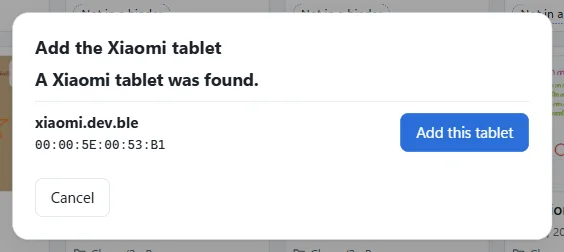

5. **Xiaomi tablet added**: Ardoise connects to it as soon as it is switched on and nothing else is using it.

If nothing is heard, Ardoise says so (**No Xiaomi tablet found**): check that the tablet is on and close, that Mi Home
is closed (or the phone's Bluetooth off) and that the PC's Bluetooth is on, then click **Look again**.

Ardoise remembers **both** tablets and connects to the one that is switched on. The panel's **Tablets** tab and
**Settings** list each one with its state, and one **Forget the tablet** per tablet (forgetting the Xiaomi leaves the Bamboo Slate
alone, and the other way round). You may know the Xiaomi only: nothing in Ardoise assumes a Bamboo Slate. The Xiaomi
tablet is recognised on *all* your PCs that use the same library.

For the Xiaomi tablet the panel shows the **battery**, the **free memory** (for example "126.4 MB of 126.9 MB"), the number
of **pages in memory** and the **model**. It has no name to change and no firmware version, and Ardoise sets its clock
at every connection: those settings do not appear for it. It is held in four positions too, though (see "The options",
below).

## 5. Getting your pages: sync

*Needs the tablet.*

### Writing on the tablet

Put a sheet of paper on the Bamboo Slate and write with its pen. At the end of a page, *a short press* of the button
saves it in the tablet's memory and moves on to the next one. (Do not hold the button for about 6 seconds: it would put
the tablet back in registration mode.)

### Receiving the pages

When the registered tablet is in range, Ardoise connects to it by itself; if need be, a short press on its button
wakes it up. The state appears in the **Tablet** block of the sidebar: **Looking for the tablet…**, **Connecting…**,
**Connected**, **Syncing…**, with the battery.

The pages are received automatically on connection, or on request with **Sync** (**Use** tab of the **Tablet** panel). A bar
shows **Page 1 of 3**… and **Cancel** stops the sync (the pages already received stay as notes, the others stay on the
tablet). The panel then summarises: **3 notes saved.**, **3 pages deleted from the tablet.** or **No new pages.**


Each page becomes a *note* at the root of the library, untitled (the card shows the date), at the tablet's size. You
can title it, file it, tag it (chapter 7).

### The options

In the **Settings** tab of the **Tablet** panel (and in **Settings**, **Tablet** section), you set one tablet at a time:
if there are two, choose it in the **Tablet to set up** list. The first two options apply to all your tablets, and the
screen says so when you know two.

- **Sync automatically when connecting**: the pages are received as soon as the tablet is in range.
- **Delete from the tablet after import** (on by default): a page is deleted from the tablet only *after* its file has
  been written to the library and checked; if anything fails, it stays on the tablet. **Warning**: the Bamboo Slate
  hands over only its oldest page. Without this option, the other pages stay unreadable until the first one is
  deleted, and the panel says so ("N pages are waiting on the tablet…"). So leave the option ticked unless you have a
  particular reason.
- For the Xiaomi tablet this option changes what **Sync** does (see "The Xiaomi tablet's pages", below): off, its
  pages are imported only on request, after a confirmation, and are deleted from the tablet all the same.
- **Tablet button in live mode** (Bamboo Slate): **New page** or **New layer** (chapter 6).
- **Position of the tablet** (Bamboo Slate): how you hold the tablet. Ardoise turns what you draw so that it appears upright. Four
  positions: **Landscape, button at the bottom**, **Landscape upside down, button at the top** (which suits left-handed
  users), **Portrait, button on the left**, **Portrait, button on the right**. The portrait positions give portrait
  notes. The button is the one next to the tablet's light.
- **Position of the tablet** (Xiaomi tablet): it can be held any way, and Ardoise turns what you write so that it appears
  upright, for the pages imported as for live mode. Four positions, drawn after the tablet (the bin erases the screen,
  the floppy disk stores the page): **Upright, buttons at the bottom** (the default), **Upright, buttons at the top**,
  **Wide, buttons on the right**, **Wide, buttons on the left**. The wide positions give wide notes (about 27 × 20 cm).
  The position in force when a sync starts applies to all its pages. During live mode, the four position buttons of the
  control window change this same setting, and the live session under way follows it at once (see "Live mode with the
  Xiaomi tablet"). An imported note keeps the position it was made in: changing the setting afterwards does not turn
  it.

### The Xiaomi tablet's pages

Write on the Xiaomi tablet, then press its store button: the page is kept in its memory. Ardoise receives the pages like
the Bamboo Slate's: when connecting, or with **Sync**. Each page becomes a note, **dated when it was stored on the
tablet**, upright (about 20 × 27 cm), or wide if the tablet is held with the buttons on the right or on the left (see
"The options").

This tablet hands over only its oldest page: the next one can be read only once that one is deleted. Ardoise therefore
**deletes each page from the tablet once its note is written and checked** (Mi Home does the same). If the note cannot
be written, or the transfer stops, the page stays on the tablet (except the page of a screen that was not erased, see
"The page of a screen that was not erased", below). A page that was already imported is recognised and not imported
again.

- With **Delete from the tablet after import** on (the default), everything happens as for the Bamboo Slate: automatic
  sync, no question.
- With that option off, Ardoise imports the Xiaomi tablet's pages **only on request**. The panel says "N pages are
  waiting on the Xiaomi tablet"; **Sync** first asks you to confirm that the pages will be deleted from the tablet
  once imported (**Sync and delete**).
- The progress counts the pages one by one, and the number of **pages in memory** goes down as it goes.
- After a transfer that did not end cleanly (stopped or cancelled in the middle of a page), Ardoise closes the
  Bluetooth link and opens it again before using it for a page or for live mode again (at once during a sync,
  otherwise when it is needed): this is normal, and it can take a moment.

#### The page of a screen that was not erased

The tablet treats the page of a screen that **has not been erased since it was stored** differently (this is the usual
case: you write, you store, you sync without erasing the screen). It **removes that page by itself as soon as Ardoise
has downloaded it**; the page of an erased screen stays until it is deleted. So that no page is lost, Ardoise does this:

- Before writing the note, it keeps a **rescue copy** of the bytes received, in the `_ardoise\rescued-pages\` folder of
  the library (file `page-<time>.bin`, with a `page-<time>.json` when the page replaces an earlier store of the same
  screen); if that folder cannot be written, in `%LOCALAPPDATA%\Ardoise\blackboard-rescue\` on this PC (a `library-…`
  subfolder per library: a copy is only imported into its own library). Once the note is written and read back, the
  copy is deleted: normally, that folder is empty or absent.
- If the note cannot be written (library unreachable, disk full), the copy stays, Ardoise says so ("A page of the Xiaomi
  tablet could not be written in the library…") and **imports the page by itself at the next sync** of the Xiaomi
  tablet, before the tablet's own pages. Check that the library can be reached and has room left.
- If neither the library nor the PC can take the copy, Ardoise keeps the page in memory and tries again at the next
  sync ("A page of the Xiaomi tablet could be written neither in the library nor on this PC…"): **do not close Ardoise**
  meanwhile.
- If the transfer of such a page did not end cleanly (cut short, more bytes than announced, not readable as pen
  records, or bytes arriving while its note was written), what was received is kept **apart**, in
  `_ardoise\rescued-pages\doubtful\`, and is never made into a note automatically; the end of the sync says so ("A page
  of the Xiaomi tablet was not received cleanly…"). If a note was made, check it. Such a doubtful copy is deleted
  automatically when the same page later comes through cleanly. You can inspect the files, or give them to
  `ardoise.exe --import-blackboard-pages FOLDER` (it reports the files that are not pen records and imports the others);
  keep the diagnostic log.

**Storing a screen again without erasing it** gives a page holding the whole screen. Ardoise then **updates the note of
the earlier store** instead of adding a second one, when that note was not modified since its import and the new page
contains the earlier one whole. Its title, tags, favourite mark and binder do not count as modifications: they are kept,
and so are its file and its creation date. In the other cases (the note's ink, layers, paper or background was changed,
it is in the trash or was deleted, or the new page does not contain it), a new note is added, as for any page.

#### The Xiaomi tablet's limits

- It talks to **one application at a time**: close Mi Home or turn off the phone's Bluetooth.
- Pages go to **whichever application imports them first**, and Mi Home deletes them too after its import: a page that
  Mi Home imported is no longer on the tablet when Ardoise connects.
- The tablet **does not give the time of each point**: replay and video of a fetched page draw the strokes at a regular
  pace. (In live mode, on the other hand, Ardoise stamps what it receives.)
- The page is about **20 × 27 cm, portrait** (landscape when the tablet is held on its side).
- Ardoise uses no Xiaomi account or online service: the tablet stays linked to Mi Home and that account.

### Automatic export for your phone

In **Settings**, **Automatic export after sync**: choose a **Format** (**Off**, **PDF** or **PNG (image)**) and a
**Folder in the library** (for example `Exports`), then **Save**. Each page received is then also written as a PDF or a
PNG in that folder: you can read your notes on your phone with the Nextcloud app. This folder is not shown in the list of
binders.

## 6. Live mode and presenting in class

*Needs the tablet.* In live mode, what you write on the tablet appears at once on screen, with the tool, colour and
width you have chosen. Each page you write becomes a note of the library, saved as you go.

### Starting live mode

Open the **Tablet** panel (click the **Tablet** block of the sidebar) and, in the **Use** tab, click **Live mode**. The state goes from
**Waiting for the tablet** to **Live** as soon as the tablet sends points: if need be, press its button briefly to
connect it. If the link drops, the state becomes **Reconnecting…** and the stroke resumes by itself.

To end, click **Finish**: each page is saved as a note (the window's counter says "N notes saved"). The `Esc` key makes
the same request, but Ardoise asks first (**End live mode?**, with **Continue** or **End live mode**), because ending
cannot be undone (see below for `Esc` and the projection). If a page cannot be written to the library (disk full,
folder unavailable…), a message explains it, the page stays in memory and a backup copy is written on this PC when
Ardoise closes. If live mode does not stop properly, **Close anyway** also stops the projection and the session, and
closes the window.

If a note of the session is renamed or tagged during the lesson (by the assistant, for instance), the following pages
keep being written to it instead of being duplicated.

### Live mode with the Xiaomi tablet

Live mode works the same way with the Xiaomi tablet: tool, colour, texture, pressure, laser pointer on hover (the
tablet also reports the pen's position when it is near the screen), other screen, sharing and touch-ups. The live page is
**portrait** (about 20 × 27 cm) when the tablet is held with the buttons at the bottom or at the top, and **landscape**
when it is held with the buttons on the right or on the left: it follows the Xiaomi tablet's **Position of the tablet**
chosen in the settings (see "The options").

As with the Bamboo Slate, the top bar of the control window has **four position buttons**, with the Xiaomi tablet's
drawings (the bin and the floppy disk show where its buttons are): if you forgot to set the position before starting,
or got it wrong, click the right one. The page in progress turns at once with what is already written on it, and what
you write next comes upright. Going from an upright position to a wide one (or the other way round) changes the shape
of the page. The choice is kept in the Xiaomi tablet's settings, as for the Bamboo: the next live session and the next
sync take it. Only the page in progress turns at once: a page already finished keeps its way round until you go back
to it, and turns when you do. The **Tablet button in live mode** setting applies to the Bamboo Slate only.

- **Storing the page with the tablet's button** does not interrupt live mode. The page is imported afterwards, like a
  sync: its note is a harmless duplicate of the live one.
- **Erasing the tablet's screen with its button** moves live mode to a **new page**: what you write next is not
  drawn over the previous page. A page that is still blank stays the current page. **Next page**, on the computer,
  works too. The tablet may also send the whole page when it is erased: Ardoise sets it aside and never draws it (no
  stray stroke); the diagnostic log says how many bytes were set aside.
- **Before live mode**, Ardoise fetches the pages stored in the tablet: erasing the screen during live mode can lose the
  page of the screen in progress if it was not fetched. With **Sync automatically when connecting** and **Delete from
  the tablet after import** both on, the panel shows the sync, then live mode starts; if the sync leaves pages on the
  tablet (a page could not be imported), live mode does not start, as below, and the result of the sync says why.
  Otherwise, if the tablet holds pages, live mode
  does not start: a window says the tablet still holds stored pages ("The Xiaomi tablet still holds 2 stored
  pages…") and offers **Import and delete** or **Cancel** (Esc too). **Import and delete** imports the pages, which
  are deleted from the tablet once imported, showing the progress, and live mode then starts by itself; if pages are
  left or the import fails, the window says so and leaves the decision to you. **Cancel** goes back to the library,
  importing and starting nothing. A tablet with no stored page starts as before, and a live session that reconnects
  after a lost link starts again at once.
- A session stays on **the tablet it started on**. If the link is lost, Ardoise waits for that same tablet
  (**Reconnecting…**) and ignores the other one until live mode ends. To carry on with the other tablet, end live mode
  and start it again.

### Resuming live mode on a sheet

*Needs the tablet.* Was the lesson interrupted, or do you want to add writing to a sheet you already saved? You can
resume live mode on that sheet.

- **From the library**: open the **⋯** menu of the note's card and choose **Resume in live mode**.
- **From the editor**: click **Resume in live mode** in the toolbar. If there are unsaved changes, Ardoise asks:
  **Save and resume live mode**, **Resume without saving** or **Stay**.

The button is greyed out while the tablet is not registered or is busy (sync under way). Select one note only.

**What happens**

- The control window, the presentation and the other screen on the network show the sheet with its background
  (template, texture, image or PDF page) and its strokes. What you write is added, on the last visible layer. Hidden
  layers are never shown in the presentation or on the other screen.
- **The note itself is written**: same file, same title, no copy. Its background image, its original, its narration,
  its recognised text and everything else it holds are kept. If you draw nothing, the file is not touched.
- **The blackboard** does not make you lose the sheet's background: when you leave it, you get the sheet's paper and
  image back. If you finish without leaving it, the sheet keeps its paper as long as you have written nothing; if you
  wrote on it in chalk, it is saved as slate so that the chalk stays readable.
- **The format**: if the sheet is not the size of the tablet, what you write is scaled down or up to fit whole inside
  the sheet, centred, without distortion. The width of the stroke does not change.
- **The orientation** (Bamboo Slate): the sheet is never turned. If it is landscape and the tablet is set to portrait (or the other
  way round), a notice tells you how to hold the tablet: "To write on this sheet, hold the tablet like this: …". The
  four position buttons are greyed out for this sheet.
- **Which tablet**: the Xiaomi tablet writes only on a page of the Xiaomi tablet (about 20 × 27 cm: its fetched pages and
  its live notes), and the Bamboo Slate on every other sheet. A Bamboo Slate sheet is therefore continued with the
  Bamboo Slate, a page of the Xiaomi tablet with the Xiaomi tablet. If the connected tablet does not fit, Ardoise
  refuses, says why (**Live mode could not resume this sheet.**) and writes nothing on the note; if the tablet only
  connects afterwards, the message comes then. **Back to the library**, or **Try again** once the other tablet is
  switched on.
- **The way round of the page** (Xiaomi tablet): an upright page of the Xiaomi tablet is continued with the tablet held
  upright (buttons at the bottom or at the top), a wide page with the tablet held wide (buttons on the right or on the
  left). If the page is not the same way round as the **Position of the tablet** set, Ardoise refuses, writes nothing on
  the note, and says what to do (**This page of the Xiaomi tablet is not the same way round as the tablet is held…**):
  choose a position of the same way round as the page in the settings, hold the tablet that way, then **Try again**, or
  resume live mode on another sheet. The Xiaomi tablet has no "hold the tablet like this" notice: it always follows its
  set position, and what you write is turned upright for that position (not for the one the page was made in, which is
  not kept for live mode). During this live session the sheet keeps its shape: of the four position buttons, only the
  two of its way round stay active (a wide sheet: buttons on the right or on the left; an upright sheet: buttons at the
  bottom or at the top), the other two are greyed out and a note next to them says why. Changing to the other position
  of the same way round (half a turn) does not turn the sheet: what you write next comes upright, what was already
  written stays as it is. The same holds while the live session keeps a page written over an image.
- **The next page** creates a new note, at the root of the library, with the sheet's paper (colour, template, texture, not
  its image), and follows the position set for the tablet again: the position buttons then work (with the Xiaomi
  tablet, only the two of the resumed sheet's way round, until live mode ends). The **Page** and
  **Background** tabs change the paper and the image of the current sheet (see **The paper and the image of the current
  page**).
- **The narration**: if you record, the sound is added after the old one without covering it, and the replay stays
  right despite the time between the two sessions. If the sound cannot be added (more than 4 hours in all, or an old
  narration that cannot be read), it goes into a new note next to the sheet, and Ardoise tells you when you finish.
- **Finish** saves the note as usual (counter "N notes saved").

**Back to the original, after a resume.** The note keeps its *first version* (see chapter 8, "Back to the original").
A resume does not make a new one each time:

- a note with no original yet (written live, imported, made in Ardoise, or a sheet still blank) gets the sheet *as it
  was before the resume*;
- a note received from the tablet gets the page *as it was synced*;
- a note that was already edited gets *its first version*, not the state just before the resume.

Only the page size, the layers, the strokes and the place of the background image come back; the title, tags,
favourite and narration stay as they are. So does the paper, unless the blackboard's slate replaced it: the first
version's paper then comes back. `Ctrl + Z` undoes it all.

**If the sheet changes elsewhere during live mode** (a copy arrives through Nextcloud, or the note is changed or deleted
on another PC), Ardoise overwrites nothing. A notice appears: "This sheet was changed elsewhere during live mode: so
that nothing is overwritten, the writing continues in a new note, next to it." (or "deleted elsewhere" if the file is
gone). The new note is in the same binder, with the sheet's image, original and narration; the version written elsewhere
stays as it is. Close the notice with **Dismiss the message**. A mere change of title, tag or favourite made elsewhere
does not create a new note.

### The control window

The screenshot shows live mode on the blackboard: the chalk writing comes from the tablet, the words "to revise" are
written in red by the teacher with the computer's pen, on the **Correction** layer (see **Correcting during live
mode**, below).

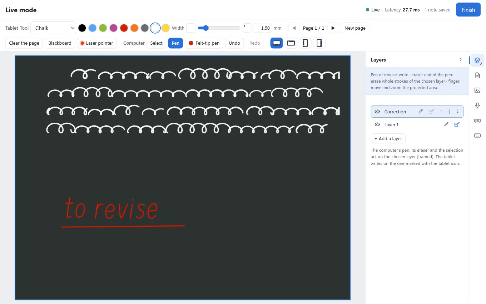

- **Tablet**: **Tool** (ballpoint, fountain pen, felt-tip, pencil, brush, highlighter, chalk), **Colour** (including
  **Chalk white** and **Yellow**) and **Width** are the tablet's style: the next stroke follows them, the previous ones
  do not change. The **Computer** group (**Select**, **Pen**, the computer's ink, **Undo**, **Redo**) is for touching up
  and correcting: see below.
- **Pages**: **Previous page**, **Next page** (the position is shown: "Page 2 / 5"), **New page**. The page's layers
  are managed in the **Layers** tab of the side panel (see **The control window's side panel** below and **Correcting during live mode**). **Clear the page** (or `Ctrl + Delete`) clears the current page only; a "Page cleared." message offers **Undo
  clearing** for 8 seconds, which gives the ink back (`Ctrl + Z` gives it back too, with no time limit: see **Touching up during live mode**). If the page has changed meanwhile, Ardoise says the clearing can
  no longer be undone.
- **Blackboard**: slate background and white chalk. **Laser pointer**: the pen hovering, without touching the tablet,
  shows a red dot on screen *without writing anything*; touching the tablet writes again. Both can also be set with
  switches, in the **Projection** tab (**Projected area** block); the toolbar buttons stay, within reach.
- **Tablet position**: four buttons that change the position at once; the current page turns with what is already
  drawn on it. With the Xiaomi tablet, they are its four positions, with its drawings (see "Live mode with the Xiaomi
  tablet").
- The preview shows the whole page; a *blue rectangle* shows the projected area. Drag it to move the area, the wheel
  zooms. **Zoom in**, **Zoom out**, **Whole page** and **Width** (the page across the whole width of the projected area)
  are also offered, in the **Projection** tab, **Projected area** block.
- **Latency**: the time between the computer receiving a point and drawing it, measured and shown (target: under
  30 ms).
- **Record the narration** (**Sound** tab): talk during the session; the sound is cut page by page and saved with each note, and the
  note's replay plays it (chapter 9).

The *tablet's button* does, during live mode, what the **Tablet button in live mode** option says (new page or new
layer). A new layer is created on top and receives the tablet's writing at once; the computer stays on its own layer.
The signal the Bamboo Slate sends when the button is pressed has been recorded on the real tablet (one press creates a
new page). The keys for next and previous page work in any case.

### The control window's side panel

To the right of the preview, a column of icons, the *rail*, holds what is set up around the page. A click on an icon
opens its tab to the left of the rail. A click on the tab that is already open, or on **›** at the top of the panel,
*collapses* it: the preview takes the whole width and the rail stays. The tabs, from top to bottom:

- **Layers**: the **Layers** zone (see **Correcting during live mode**). This is the tab that is open at the start.
- **Page**: the **Paper** of the current page (colour, template, texture); see **The paper and the image of the current
  page** below.
- **Background**: the **Background image or PDF** of the current page; see the same section.
- **Sound**: **Record the narration** during the session.
- **Projection**: the **Projector** (the projection screen, **Project**, **Stop projecting**), the **Projected area**
  (zoom, **Whole page**, **Width**, the **Blackboard** and **Laser pointer** switches) and **Network sharing**: the
  **Share on the network** button is no longer in the toolbar.
- **Help**: the live mode shortcuts (see chapter 17).

Ardoise remembers the open tab and the collapsed state of this window, on this PC, and finds them again at the next
live mode.

**The badges** show when the panel is collapsed too: the *number of layers* on **Layers**; an *orange dot* when the
tablet's layer, or the chosen layer, is hidden (the warning of the **Layers** zone says which); a *red dot* on **Sound**
during a recording; a *blue dot* on **Projection** while a projection or a share is running.

**Above the open tab**, whichever it is, comes the selection bar ("Selected strokes: 3", **Delete**, **Deselect**) and,
while the **Select** or **Pen** tool is on, its one-sentence help. When strokes are chosen, the panel opens again if it
was collapsed.

**With the keyboard.** `↓` and `↑` move from one icon to the next, `Home` and `End` go to the first and the last,
without opening anything; `Enter` opens the tab or collapses it. `Space` does not do that here: in live mode it always
means "next page", even when an icon has the focus. The same goes for `Page Down` and `Page Up` when a list
(**Template**, **Placement**) or a slider (**Opacity**) of the **Page** and **Background** tabs has the focus: they
always turn the page, so that the room's remote works after a choice made with the mouse; those lists and that slider give
the focus back after each choice anyway.

### Touching up during live mode

*Needs the tablet.* A mistake to remove, a word to turn red? You do not need to leave live mode or open the editor. You
touch up in the control window, and **the tablet keeps writing meanwhile**.

**Choosing strokes**

- Click **Select** (the **Computer** group) in the toolbar, or press `V`. Pressing it again leaves the tool. **Select**
  and **Pen** (see **Correcting during live mode**) exclude each other: choosing one leaves the other.
- **Lasso**: in the preview, press with the mouse and draw around the strokes, then release. A stroke is chosen when at
  least half of its points are inside the lasso.
- **Click**: click a stroke to choose it alone. Click on the ink itself, not next to it.
- `Shift` + lasso or click adds strokes to the ones already chosen. `Ctrl` + lasso or click removes some.
- A gesture on empty paper, or `Esc`, clears the selection. While strokes are chosen, `Esc` does nothing else.
- A finger outside the selection's frame and the wheel still move and zoom the preview.
- The chosen strokes are outlined in blue in the preview. The selection bar, above the open tab of the side panel, says
  "Selected strokes: 3" (see **The control window's side panel**).
- **Only the strokes of the chosen layer are picked** (the **Layers** zone, see below); choosing another layer clears
  the selection. You cannot choose the stroke the tablet is writing right now, nor the strokes of a hidden layer;
  hiding a layer takes its strokes out of the selection. On a resumed sheet, you can choose the sheet's old strokes, by
  choosing their layer.

**Moving and resizing**: the chosen strokes are surrounded by a dashed frame, with a small square at each of its four
corners.

- **Move**: put the pen, a finger or the mouse **inside the frame** (or very near its edge: the pen and a finger do not
  have to aim exactly) and drag. The strokes follow, and land where you let go.
- **Resize**: take a **corner**: near the square, a little outside the frame works too, especially with the pen and a
  finger. Drag along the diagonal. The opposite corner stays where it is; the thickness of the line follows
  the size. You cannot go below a twentieth of the size, nor above twenty times.
- A plain press in the frame, without dragging, changes nothing: it does not make a new selection. With `Shift` or
  `Ctrl`, a gesture is always a lasso, even on the frame. Outside the frame, the mouse and the pen draw a lasso as
  before and a finger moves the preview.
- During the gesture the strokes are shown lifted, where you are taking them, and the place they leave is empty. `Esc`
  (or a second finger, which turns the gesture into a zoom) drops the gesture: the strokes stay where they were and
  nothing is sent.
- **The projector and the other screen on the network only move on release**: they show the result, all at once, never
  the frame or the squares. The selection stays, to move again or resize. `Ctrl + Z` puts the strokes back (one step per
  move or resize).
- In the editor, the frame and its corners are taken the same way.

**Deleting**: click **Delete** in the selection bar, or press `Delete` or `Backspace`.

**Changing the colour**: click a **Colour** swatch. Only the chosen strokes change, and the new colour shows at once
inside the blue outline. They stay chosen, so that you can try another colour. **The pen's colour does not change**: what the tablet writes next keeps its colour. With nothing
chosen, a swatch sets the pen's colour, as before.

**Undo and redo**

- `Ctrl + Z` (or **Undo**) undoes the computer's last action: a stroke or an erasing (see **Correcting during live
  mode**), a deletion, a change of colour, a move or a resize, or **Clear the page**. Deleted strokes come back to their place.
- `Ctrl + Y` or `Ctrl + Shift + Z` (or **Redo**) does again what was just undone. A new touch-up empties what could be
  redone.
- **What is never undone**: what the tablet wrote. A stroke written in the meantime stays, whatever order you undo and
  redo in. Changes of tool, pen colour or width, page changes and layer operations are not touch-ups either.
- Each page has its own list, which keeps the last 100 touch-ups. If you leave a page and come back to it, `Ctrl + Z`
  still undoes its touch-ups. The lists are gone when you finish live mode.
- The **Undo** and **Redo** buttons are greyed out when there is nothing to do.

**The projector and the other screen on the network only see the result.** Never the blue outline or the lasso: a
deleted stroke disappears, a recoloured stroke changes colour, a moved or resized stroke appears at its new place. The annotations drawn over the presentation are not
strokes of the page: they cannot be chosen.

**In the note.** When you finish, the note holds what was on screen: deleted strokes gone, colours changed. On a resumed
sheet, the touch-up of an old stroke is written into the note itself; "Back to the original" (chapter 8) always gives
back the first version.

### Correcting during live mode

*Needs the tablet.* In class, a pupil writes on the tablet, projected live, and you correct at the same time with your
computer's pen (a Surface, for example), in another colour and **on a layer of your own**: what you write is saved in
the note, without mixing with the pupil's writing. The tablet keeps writing meanwhile, and is never held up.

**Two layers, two marks.** The **Layers** zone, in the **Layers** tab of the control window's side panel, lists the page's layers,
the highest first.

- The *frame* surrounds the **chosen layer**: that is where the computer acts (pen, eraser end of the pen, selection).
  A click on a row chooses its layer.
- The *tablet icon* marks the layer the **tablet writes on**. It stays on its layer until you send it elsewhere.

When live mode starts, the computer is on the same layer as the tablet: you add your layer when you need one.

**The Pen tool.** Click **Pen** (the **Computer** group) or press `P`; pressing it again leaves the tool. In the
preview:

- the *pen* and the *mouse* write on the chosen layer;
- the *eraser end of the pen* erases whole strokes of the chosen layer, whatever the tool (a small circle follows the
  eraser); the strokes of other layers are never touched;
- a *finger* never makes ink: it moves and zooms the projected area, as before.

**The computer's ink.** It is separate from the tablet's: **red** by default, in felt-tip. The button after **Pen** (a
colour dot and the tool's name) opens **Computer's ink**: **Tool**, **Colour** and **Width**. These settings touch
neither the tablet's style (the **Tablet** group) nor a selection; Ardoise remembers them from one session to the next,
on this PC. `Esc` or a click elsewhere closes the panel.

**An example in class.** The pupil writes their exercise on the tablet; you want to correct it in red, without mixing
anything into their writing.

1. In the **Layers** zone, click **Add a layer**. The new layer goes on top and becomes the chosen layer; the tablet
   stays on the pupil's layer.
2. Click the pencil next to its name, type "Correction", then `Enter`.
3. Click **Pen** (or `P`). The ink is already red.
4. Write on the preview with the computer's pen *while the pupil writes*. Your stroke appears at once on the projector
   and on the network screen, like the tablet's.
5. A mistake of yours: pass the eraser end of the pen over it, or press `Ctrl + Z`.
6. To touch up what the pupil wrote, click their layer in the zone, then use the pen's eraser or **Select**.

**What the projector and the share show.** Both layers, mixed, as on screen, except hidden layers, which they never
show. Neither the frame, nor the lasso, nor the eraser's circle is projected.

**Undoing with `Ctrl + Z`.** It undoes the *computer's* actions: a stroke, an erasing, a touch-up, **Clear the page**
(see **Touching up during live mode**). Never what the tablet wrote. Layer operations (adding, hiding, renaming,
moving, merging) are not undone by `Ctrl + Z`: to undo a hiding or a move, click the same thing again.

**Sending the tablet to another layer.** Hover over another layer's row: a pale tablet icon appears; click it. (On a
touch screen, these icons are always visible.) What the pupil writes next goes on that layer; what they already wrote
does not move. If the tablet's button is set to **New layer** (**Tablet button in live mode**, chapter 5), one press
creates a layer on top and sends the tablet there; the computer stays where it is.

**The other gestures of the Layers zone**

- The *eye* hides or shows a layer; it is *crossed* when the layer is hidden, and the name turns grey italic.
- The *pencil* renames: `Enter` keeps the new name, `Esc` gives the old one back.
- On the chosen row only, **↑** and **↓** move the layer up and down, and **⤓** merges it into the layer below.
  **Merging during live mode cannot be undone**: `Ctrl + Z` does not undo it, and the page's undo list is emptied (the
  other pages' lists are not touched; **Undo clearing** goes too). So Ardoise asks first: "Merge “…” into “…”? Ctrl+Z
  will not be able to undo it.", with **Merge** and **Cancel** (`Esc` answers **Cancel**). When the layer below is
  hidden, the question says so too: once merged, its content will be projected and shared (the merged layer shows).
- **Add a layer** creates a new one, on top.
- The zone's buttons are greyed out when live mode is not running.

**The warnings.** They appear under the list.

- *"The tablet writes on "…", which is hidden: what the pupil writes is neither projected nor shared."* The pupil's
  writing is saved in the note all the same, but nobody sees it: show the layer again, or send the tablet to another
  one.
- *"The chosen layer, "…", is hidden: show it to write on it."* The pen does not write while the chosen layer is hidden
  (the same message appears if you try), and the eraser and the selection find nothing there.

**In the note and in replay.** The layers, their names and their state (shown or hidden) are saved in the note, with
each of the computer's strokes next to the pupil's. In replay (chapter 9), the computer's strokes appear at the time you
wrote them, mixed with the pupil's. The annotations drawn over the presentation (see below) do not change: they are
never saved.

### The paper and the image of the current page

*Needs the tablet.* During live mode you can
change the paper of the page on screen and put a worksheet or a document *under* the writing, without stopping the
tablet: a pupil is writing, you go from white to Seyès, or you put an exercise's text down for the class to complete. The
change appears at once on the projector and on the share's screen, and it is saved with the page. The **Page** and
**Background** tabs are greyed out until live mode is running.

**The paper** (**Page** tab, **Paper** block): the same settings as in the editor, the colour as swatches (**White**,
**Cream**, **Kraft**, **Black slate**), the **Template** (**Blank**, **Lined**, **Seyès**, **5 mm squares**, **Graph paper
(mm)**, **Dotted**, **Music staves**) and the **Paper texture** switch.

- **A new page keeps the paper** (colour, template, texture) of the page that was on screen when you created it, but
  *never its image*. A page that already exists keeps its own: changing the paper of page 3 does not touch page 2. A new
  session starts again on plain white.
- **The blackboard**: while it is on (`B`), the colour swatches are greyed out and a sentence says so: the chosen colour
  *comes back when the blackboard is turned off*. The template and the texture apply at once. Choosing **Black slate** with
  the blackboard off gives a black paper on which the tablet's writing stays black: to write in chalk, turn the blackboard
  on instead.
- **You cannot go back with `Ctrl + Z`**, which only undoes what the computer writes: choose the previous setting again.
- A page that has neither writing nor image is not saved, even if you changed its paper.

**The image** (**Background** tab, **Background image or PDF** block): **Choose a PDF or an image…**, the PDF page if there
are several (one thumbnail per page, as in the editor: see below), then **Put in the background**. The image (PNG or JPEG) or the PDF page goes *under* the writing of the
current page, **Whole** (all of it visible, without distortion); **Placement** (**Whole**, **Fill the page**,
**Stretched**), **Opacity**, **Turn the image alone**, **Replace…** and **Remove the image** then set it, as in the editor
(chapter 8). Importing a PDF page can take a few seconds: the tablet goes on writing meanwhile.

- **A new page has no image.** Going back to the previous page finds its own: the worksheet can be on page 2 and a photo
  on page 3.
- **The image is saved with the page**, as the note's background image. A page that has only the image, with nothing
  written yet, still becomes a note, so that a worksheet shown in class is kept. If you then remove the image, the note
  stays in the library, empty: move it to the trash if you no longer need it.
- **Ardoise does not offer to switch the sheet to portrait or landscape** (a live page follows the tablet): the worksheet
  is placed as it is, and a portrait worksheet on a landscape page is shrunk. Hold the tablet in portrait *before* writing
  for it to fill the page: as long as the page has no writing, it follows the tablet and the image is placed again with
  the same placement.
- **A page that has an image and writing no longer turns with the tablet**, like a resumed sheet: the position buttons are
  greyed out, Ardoise says how to hold the tablet, and the next page follows the set position again. If you remove the
  image, the page follows the tablet again: it turns at once, writing included.
- On a **resumed sheet** (see above), changing the paper or the image is a deliberate change: it is saved in the note even
  with no new writing. **Back to the original** (chapter 8) gives back the earlier writing, not the paper nor the image.
- **On the share's screen**, the paper and the image are sent once as a picture; the other computer shows the paper's
  colour until it has received it.

### Projecting on a video projector

1. Plug in the projector and, in Windows, press `Win + P` and choose *Extend*: each screen has its own desktop.
2. In the **Projection** tab of the control window's side panel, **Projector** block, choose the **Projection screen** in the list (the **Refresh the
   list of screens** button updates it) and click **Project**.
3. A *presentation* window opens *full screen on the chosen screen*, with no interface element at all (the mouse
   cursor disappears after 2 seconds without moving). The control window stays on the computer's screen. What you
   write appears on both.

   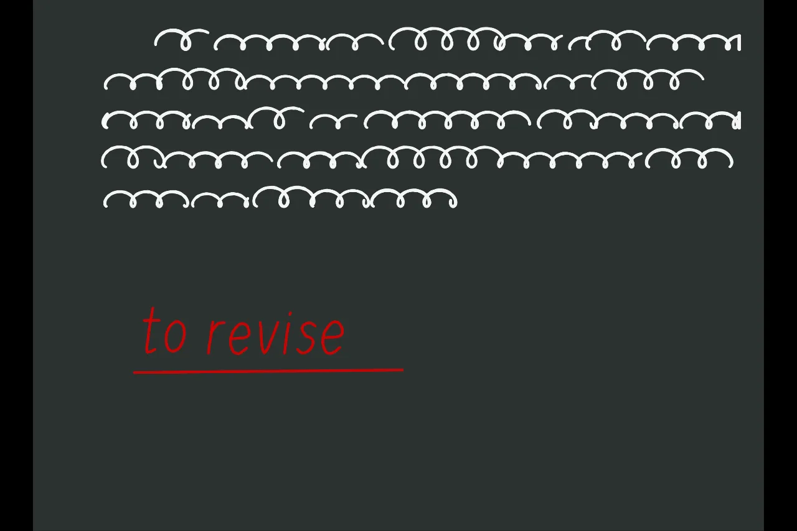

4. **Stop projecting** closes the presentation. Ardoise remembers the chosen screen on this PC.

With a single screen, the presentation covers the control window: press `Esc` in the presentation to close it. There
are never two projected windows at once: projecting live mode closes the projection of an editor note (chapter 8), and
the other way round.

*What `Esc` does.* In the control window as in the presentation, while the projection is shown, `Esc` closes it (as in
a slideshow); when nothing is projected, `Esc` asks whether to end live mode. *`Space` always means "next page"*, even
when a button of the window has the focus: it never presses that button (which is what prevents wiping the next page by
mistake).

### Writing over the presentation

On the projected window you can annotate the page with the pen, a finger or the mouse: the annotations are red (yellow
on the blackboard). The back of the pen erases them one by one; the **Clear the marks** button (which appears with the
cursor) or the `Delete` key erases them all; they also disappear when the page changes. *They are never saved in the
note.* While the sheet is shared on the network (see below), the other computer shows them too. Two fingers
zoom the projected area.

### On the keyboard

The same keys work in the control window and in the presentation (a presentation remote sends Page Down and Page
Up): see chapter 17, or the **Help** tab of the side panel.

### Showing the sheet on another computer of the network

*Sharing live mode needs the tablet; sharing a note open in the editor does not. This sharing has been checked by
automated tests (server, the other screen's page, simulated tablet), and tried on two real computers of the same
network, at home, then at work through the school's web filter. Still to be confirmed in use: Chrome on Android, and
an open note shared on the school's network.*

Another computer on the same network (for instance the classroom PC linked to the projector) can show the sheet in a
*plain web browser*: nothing to install on it. It shows:

- during live mode, the live sheet, like the presentation window (zoomed area, blackboard, laser pointer, marks
  written over the presentation);
- when a note is open in the editor, that note's page, including your unsaved changes;
- otherwise (library, settings), a waiting screen.

*Nothing else is reachable*: not the library, not the notes' titles, not the other notes, not a file of the PC. The
other computer cannot change what is shown, but it can adjust its own display (see below).

**On the Ardoise side.** Open the **Projection** tab of the side panel, in the live mode control window or in the editor,
and click **Share on the network** (**Network sharing** block). The panel that opens gives:

- the *address* to type in the other computer's browser, like `http://192.168.1.23:8765` (if the PC has several, all
  are listed);
- a *QR code* of that address, to scan with a phone or a tablet;
- the 6-character *access code*, in two groups of three (for example `K7M Q2X`);
- the *number of connected screens*, and what is shown;
- **Pause** (the image freezes on the screens; you keep writing, then **Resume** shows the current state) and **Stop
  sharing**.

While a share is running, an indicator with the number of screens stays at the top of the library, the **Share on the
network** button of the **Projection** tab shows it too (a click reopens the panel), and the **Projection** icon of the
rail carries a blue dot, even when the panel is collapsed.

**On the other computer.**

1. Open a browser (Edge, Chrome, Firefox…) and type the address *in full, with `http://` and the port number*:
   `http://192.168.1.23:8765`.
2. Type the access code (upper or lower case, with or without the space).
3. The sheet appears. Press `F11` or the page's full-screen button (or double-click) to show it on the whole screen;
   the button disappears with the cursor.

**Adjusting the display on the other computer.** Move the mouse (or touch the screen): a bar of buttons appears at the
bottom of the page, then disappears after a few seconds. These settings only concern this screen: they change nothing
on the Ardoise PC or on the other screens.

- **Whole page**: the entire page is visible (key `0` or `Home`).
- **Full width**: the page fills the width of the screen; you see the top of the page, and you go down by dragging it
  (key `W`).
- **Zoom in** and **Zoom out** (keys `+` and `-`): to look at a spot more closely. The mouse wheel zooms at the
  cursor; on a touch screen, spread or pinch two fingers.
- To move the page when it is not shown whole: drag with the mouse or with a finger, or use `Shift` + the arrow keys.
- **Follow the PC** (key `Esc`): during live mode, the screen first follows the view chosen on the PC (zoom, position).
  As soon as you adjust the display here, it keeps your setting; this button, which then appears, goes back to the PC's
  view. The blackboard and the laser pointer always stay the PC's.
- `F`: full screen (like `F11`).

If the PC moves to another page, "Whole page" and "Full width" stay on; a free zoom goes back to the whole page.

If the connection drops for a moment, the page reconnects by itself and catches up. When you stop the share or close
Ardoise, it says that the sharing has ended.

**The Windows firewall.** The first time, Windows shows a "Windows Security Alert" window (*Windows Defender Firewall
has blocked some features of this app*). Tick **Private networks**, then click **Allow access**. Administrator rights
are needed: on your own PC that is you; otherwise ask your IT department to allow `ardoise.exe` on the private
network. Ardoise never changes the firewall itself.

- *A network Windows calls "public".* Many school networks are classed "Public". Either set this network to "Private"
  (**Settings** > **Network & internet** > the properties of the Wi-Fi or Ethernet network > **Network profile type**:
  **Private network**), or also tick **Public networks** in the firewall window, knowing that the access code is then
  the only protection.
- *The window was closed without choosing.* Open **Windows Defender Firewall** > **Allow an app or feature through
  Windows Defender Firewall** > **Change settings** > **Allow another app…** > **Browse…** > `ardoise.exe`, then tick
  **Private** (and **Public** if need be) for Ardoise.
- Windows ties this permission to the *program* at its location: `ardoise.exe` in this folder, whatever the port. If
  you move or rename `ardoise.exe`, or start another copy, Windows asks again: answer the same way. Changing the port
  does not make it ask again.
- The *port* is 8765 by default. It does not change from one share to the next, so the address stays the same, and your
  IT department can open that port. No other program can take this port during a share.
- If another program already uses this port, Ardoise takes the first free port after it (8766, 8767…) by itself and
  says so at the top of the panel: "Port 8765 is used by another program: the share uses port 8766, kept for this PC."
  That port is remembered for this PC: at the next shares the address stays the same. Just type the address the panel
  shows. If none of the 20 ports after it is free, Ardoise says so and does not start the share.
- To choose the port yourself, open **Settings** > **Sharing on the network** > **Share port**, type a number from 1024
  to 65535 and click **Save**. The choice applies to this PC only. A share that is already running keeps its port; the
  new one is used by the next share. Changing the port does not ask for the firewall permission again, but the other
  computer must type the new address.

**Privacy.** The share starts only when you click, and stops with **Stop sharing** or when Ardoise closes (the port is
then closed again). The code changes at each share. After 5 wrong codes in 5 minutes, the computer concerned has to
wait (the page says how long), without bothering the others. The exchanges are *not encrypted* (it is plain `http` on
the local network): use this sharing only on a network you trust, and not for confidential notes on an open network.
The writing and the image of the shared notes can be seen by anyone who has the address *and* the code.

**If it does not connect.**

- Are the two computers on the *same network* (same Wi-Fi or same network socket, not an isolated "guest" network)?
- Is the address typed with `http://` and the port (`:8765`)? Use the one the panel shows, not one from another day:
  the port may have changed if another program held 8765.
- Has the firewall been allowed for this type of network (see above)? This is the most frequent cause.
- The page says the code is wrong: read the panel's code again (there is no `0`, `O`, `1`, `I` or `L`).
- The page says there are too many screens: the share accepts 32 screens at a time (4 per computer). It tries again
  by itself every 5 seconds.
- The browser only shows "Misdirected Request": type the address in figures that the panel shows. For safety, the
  share refuses names with a dot (like `pc.school.lan`); it accepts the computer's short name, if the network knows
  it.
- Security software or the school network may also block connections between computers: ask your IT department to open
  the port the panel shows (usually 8765) to your PC.

## 7. The library

### Browsing

The library is the home page. At the top: the **Search notes** field, the sort (**Sort notes**: **Date: newest first**,
**Date: oldest first**, **Title: A → Z**, **Title: Z → A**, and, when a binder is shown, **Binder order**, see below), and the **New note**, **From a PDF or an image…** and
**Settings** buttons. On the left: the sidebar with **All notes**, **Favourites**, the **Binders**, the **Tags**, the
**Trash**, the **Import from Inkspace…** entry (chapter 11), and at the bottom the **Tablet** block and the **Test the
tablet** button.


A card shows the thumbnail, the title (or the date if the note has no title), the date, the binder and the tags. A click
opens the note in the editor. On the card: the box to *select* it, the favourites star, the **Actions for…** menu (**Rename**,
favourites, **Resume in live mode** (chapter 6), **Duplicate**, **Change the date…**, **Move to trash**) and a handle,
which appears on the card, to drag the
note out of Ardoise (chapter 10). A **right click** on a card opens the same menu. Renaming a note also renames its file.

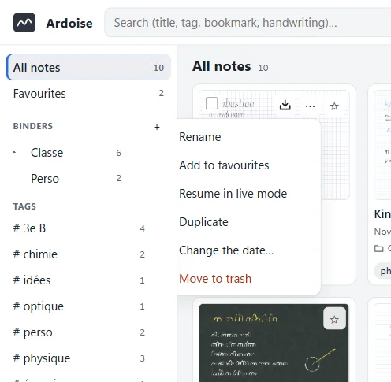

**The right click** never shows a web page's menu ("Save image as…", "More tools"…): Ardoise shows its own menu, or nothing.
The menu opens **under the pointer** (the `Menu` key, or `Shift + F10`, on a card or a binder opens it under its **⋯** button).
There is one on: a card and a binder (above); **All notes** and **Favourites** (**Show**, **Select all**); a tag (**Show**,
**Colour…**, which opens the colour palette); the **Trash** (**Open the trash**, **Empty the trash…**, with the same
confirmation question as the button); a note in the trash (**Restore**, **Delete permanently…**, which asks to confirm); a
layer and the editor's page (chapter 8). The arrows, `Home`, `End` and `Enter` drive the menu; `Esc`, a click elsewhere,
scrolling or a change of window close it. In a text field the right click keeps Windows' menu (cut, copy, paste). Anywhere
else, nothing happens.

Thumbnails are kept in a cache of each PC. When a note changes on another computer (Nextcloud sync), the library
updates by itself.

Messages may appear above the notes: **Unreadable files: N** (see below) and, after Ardoise stopped abruptly, the list
of unsaved changes that can be recovered (chapter 8).

### Binders

A binder is simply a *subfolder* of the library. Click the **New binder** icon (or **New sub-binder in…** next to a
binder), type the **Binder name** and click **Create**. To file notes, drag them onto a binder in the sidebar, or
select them and use **Move to…** (**Library (root)** takes them back to the root).

Under the date, each card names the note's binder, with its whole path if it sits inside another binder (for example
`Classe/3e B`). A note in no binder, so at the root of the library, says **Not in a binder**: you see at a glance what is
left to file. As a note is a file, it is in one binder at a time.

To rename, export, print or delete a binder, open the **⋯** menu ("Actions on the binder…") next to its name in the
sidebar, or **right-click** its name:

- **Rename…**: type the new name, then **Rename** (**Cancel** or `Esc` gives up). The folder is renamed and its notes
  follow. Ardoise never replaces a binder or a file with the same name: it warns you and lets you pick another.
- **Export the binder as a PDF…** and **Print the binder…**: see chapter 10.
- **Delete…**: Ardoise asks for confirmation, saying how many notes (and sub-binders) the binder holds. **Delete the
  binder** sends its notes to the **Trash**, then removes the folder. Nothing is destroyed: each note restored from the
  trash goes back to its binder. A folder that still holds files that are not notes is kept, and the message says so.
  An **Undo** message stays on screen for a few seconds (see "The trash" below): it brings the binder back with its
  notes.

### Arranging the notes of a binder in the order you want

When a binder is shown, the **Binder order** sort arranges its notes as *you* decide, instead of by date. In the other views
(**All notes**, **Favourites**, a tag) this choice is not offered and the notes are sorted by date, newest first; your choice
comes back as soon as you open a binder again.

- **By dragging**: drag a card (or the whole selection, if the card is part of it) *between two cards*: a vertical bar shows
  where it will land (on the left half of a card, before it; on the right half, after it). Selected notes move together and keep
  their order. Dropped on a binder of the sidebar, the note changes binder, whatever the sort.
- **From the keyboard**: `Alt + Left arrow` or `Alt + Right arrow` moves the focused card (or the selection) one place;
  `Alt + Home` or `Alt + End` puts it at the start or the end. A screen reader announces the new place ("Beta moved to
  position 1 of 3").
- **A parent binder** shows its own notes first, then those of each sub-binder in that sub-binder's order (the sub-binders in
  the sidebar's order). A card only moves among the notes of its own binder: arrange a sub-binder by opening it, or by dropping
  its note next to another note of the same sub-binder.
- **A note that arrives** (tablet, new note, a note moved into the binder, a restored note) goes to the end; a copy (see below) goes
  right after its original. During a **search** the notes keep the binder's order but cannot be moved: clear the search to arrange
  them.
- **The order is saved in the binder itself**, in the small file `_ardoise-order.json` (next to the notes), so it follows the
  synchronisation. Each binder has its own order. The editor's **Previous page** and **Next page** buttons, and the export of
  several notes, follow the order shown. If the file is missing or damaged, the notes are simply sorted by date and nothing is
  lost. If two PCs arrange the same binder at once, Nextcloud keeps a "conflicted copy" of the file: the most recent arrangement
  is used, and no note is lost (a note that arrangement does not mention goes to the end).

### The summary of a binder

To find a passage across a whole binder, put **bookmarks** in your notes (see **Putting bookmarks**, in chapter 8): a word or a
short phrase at the right spot of the page ("Chapter 3", "Answer to exercise 2"). When a binder is shown, the **Summary** button of
the top bar (or **Binder summary…**, in the binder's **⋯** menu) opens the binder's summary, **in the binder's order**
(**Binder order**, above: the one you arranged, otherwise by date, oldest first), the notes of its sub-binders after its own. What it
holds is set in the **In the summary** group, three independent choices:

- **The sub-binders** (a box, offered when the binder has some): their name, as a heading above what they hold;
- **The notes**: **Title** (a line per note; an untitled note is called **Untitled note**, followed by a number when there are
  several: "Untitled note (2)"), **Title or date** (an untitled note carries its date) or **No** (no note line);
- **The bookmarks** (a box): those of each note, in the order of the page.

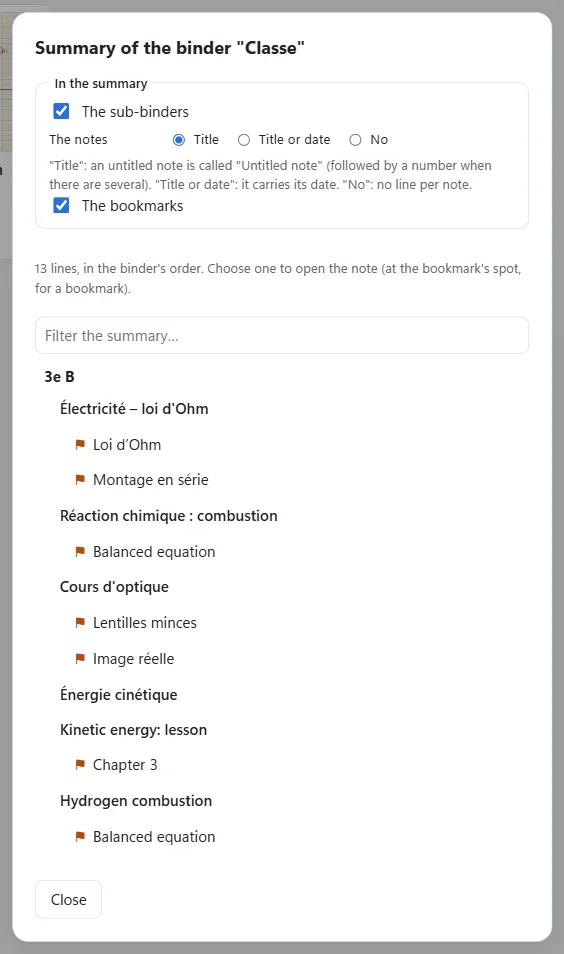

At first: the sub-binders and the bookmarks, no line per note, that is a book's contents. The bookmarks then stand right under the
name of their sub-binder (or at the top, for the notes of the binder itself); a note without a bookmark gives no line, and a
sub-binder with nothing left has no heading. **A binder with no bookmark at all** would start with an empty summary: until you have
chosen something, its notes are listed (the window says so); as soon as you choose, your choice is taken as it is, even if it leaves
nothing (a sentence then says why the summary is empty). Your choices are remembered on this computer, and are the same for the
bookmarks and the summary page of the binder's PDF (see **Exporting or printing a binder**). The former "Show dates" box is picked
up: if you had ticked it, the notes are set to **Title or date**. A click on a note line (or `Enter`, after walking through the
list with `Tab` or the arrows) opens the note; on a bookmark, it opens the note **at that spot**: the bookmark is selected and in
the middle of the editor. The **Filter the summary** field keeps the lines whose text holds the words typed, with the headings above
them and what they hold. The summary is not shown again when you come back from the note; open it again with the same button.

### Duplicating a note, changing its date

- **Duplicate** (the card's menu, right click, or the selection bar for one or several notes) makes a copy in the *same
  binder* with the *same creation date*, its title followed by **(copy)** ("Course (copy)", then "Course (copy 2)" for the copy of a
  copy; an untitled note gives "(copy)"), without the favourite mark. The ink, layers, paper, background image, tags, the
  **narration** and the **tablet's original** are copied: **Back to the original** works on the copy. A copy of an *assistant's
  retouched copy* stays a retouched copy. An **Undo** message (or `Ctrl + Z`) puts the copies in the trash.
- **Change the date…** (the card's menu, right click) opens a small window: **Today** fills the field with the current date
  and time, or type a **New date and time**, then **Change the date**. This is the date the note shows, the one the library sorts
  it by, and the one that starts its file name; the writing and the sound do not change. **Undo** puts the old date back.
- *With the tablet*: a copy is not "the note of a page" of the tablet, and changing the date of an imported note does not make
  its page come back at the next sync (Ardoise recognises it by its identifier). One special case: a screen of the Xiaomi tablet
  stored again updates its note; if you dated that note *after* the previous storing, a new note is added instead of updating it
  (nothing is lost or overwritten).

### Tags and favourites

Select one or several notes, click **Tags…**, type a tag (several, separated by a comma) and click **Add**; an existing
tag is removed with its cross. A click on a tag in the sidebar, or on a card's tag, shows only the notes that carry it.
The star of a card (or **Add to favourites**) adds it to the **Favourites**. You can also drag a card (or the whole
selection) onto **Favourites** or onto a tag of the sidebar: the notes become favourites, or get that tag, and stay in
their binder.

*Tag colours.* The small dot next to a tag, in the sidebar and in the **Tags…** panel (under **Existing tags**), opens a
palette of eight colours, readable in the light theme as in the dark one: **Red**, **Orange**, **Yellow**, **Green**,
**Teal**, **Blue**, **Purple**, **Pink**; **No colour** removes it. On the keyboard, the arrows move between the
colours, `Enter` chooses and `Esc` closes. The colour changes on every note that carries the tag: you see it on the
cards, in the sidebar and in the panel. It belongs to the *library* (the file `_ardoise\tags.json`), not to the notes:
all your PCs see it, through Nextcloud. If two PCs change the colours at the same time, Ardoise merges tag by tag, the
most recent change winning.

### Selecting several notes

Tick the cards, or: `Ctrl + click` adds or removes a note, `Shift + click` selects a range, `Ctrl + A` selects all,
`Esc` deselects. An action bar appears: **Move to…**, **Tags…**, **Export…**, **Print…**, **Assemble…**, **Duplicate**, **Turn**,
**Add to favourites** (or **Remove from favourites**), **Move to trash**, **Deselect**.

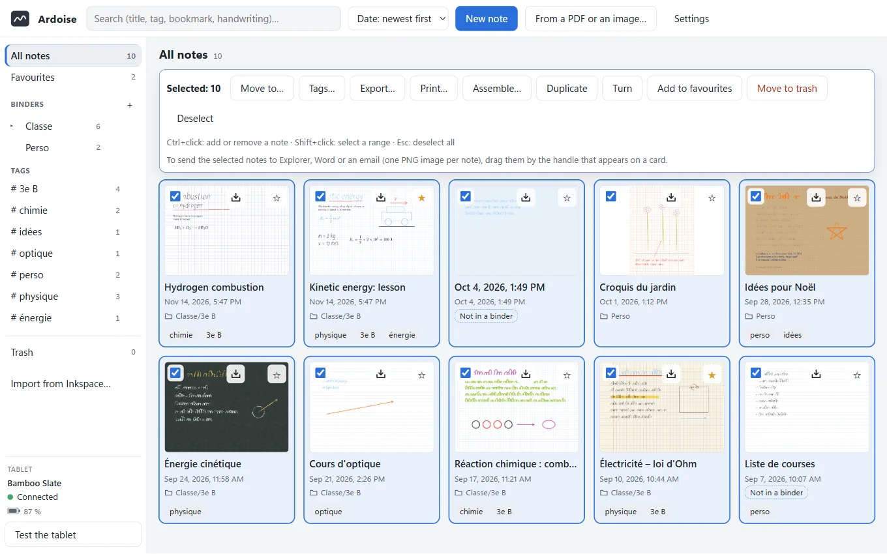

**Turn** rotates *all* the selected notes at once: choose **A quarter turn to the left** or **A quarter turn to the
right**. The sheet, the writing and the background image turn together, exactly like **Turn the sheet with the writing**
in the editor (chapter 8). A bar shows progress ("Turning the notes: 2 of 5"), **Stop** interrupts the operation between
two notes, and the notes that could not be turned are listed with the reason. The **Undo** message puts the notes back
the way they were (see "The trash").

**Assemble** (at least two notes) creates a new note without changing the originals: **Overlay on one page** (all the
notes on a single page, each on its own layers) or **Place end to end (long page)** (the notes one under the other).
Give the **Title of the new note** and click **Assemble**. Only the first note's background image is kept.

### Creating a note

- **New note**: a blank A4 page in landscape, in the binder on display.
- **From a PDF or an image…**: one note per chosen page of the PDF (**All pages** or **Some pages**, for example
  `1-3, 5`), at the size and in the orientation of the page, with the page in the background so you can write over it. For a
  PDF of several pages, the window shows **a thumbnail of each page**, drawn as you scroll (even a PDF of several hundred pages
  opens quickly): a click chooses or removes a page, **Shift + click** chooses a whole run of pages from the last one clicked,
  **All** and **None** take or remove them all; the field of page numbers is still there and follows the thumbnails (and the
  other way round). With the keyboard: the arrows move the cursor over the pages, `Space` chooses the page, `Shift + arrow`
  extends the run, `Ctrl + A` chooses them all. The **Create N notes** button starts the creation.

  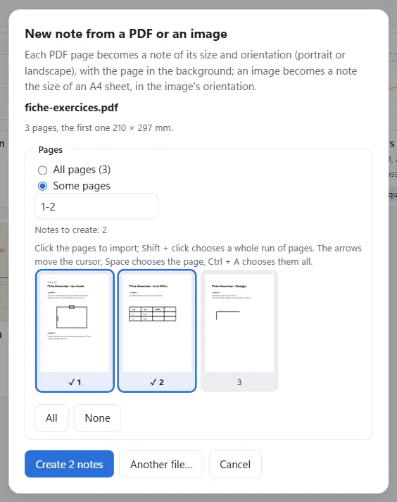

  An image gives a note the size of an A4 sheet, in the image's orientation. PDFs protected by a password are not read:
  save a copy without a password. For a long PDF, a bar shows progress ("Creating the notes: 3 of 12…") and **Cancel**
  stops the creation: no note is then kept ("Cancelled: no note was kept").

### Searching for a note

Type in **Search notes**: Ardoise searches the *titles*, the *tags*, the *bookmarks*, the *typed texts* (**Text** tool, and the code
of the equations, on the layers shown) and the *handwriting*, ignoring accents and capital letters. Notes found through the handwriting are grouped under **Found in the handwriting**. `Ctrl + F` puts
the cursor in the field, `Esc` clears it.


Searching the handwriting uses *Windows' handwriting recognition*, offline, on this PC. The language module must be
installed in Windows (French usually is; for English: *Windows Settings > Time & language > Language & region*, the
language, then *Language options > Handwriting > Download*, then restart Ardoise). The settings are in **Settings**,
**Handwriting recognition**: **Handwriting language** (**Automatic**, **French**, **English**), the state of the
reading, **Stop reading** and **Resume reading**. Notes are read in the background; reading pauses during live mode and
the presentation, and a message says how many notes have been read ("Reading the handwriting: 12 of 40 notes."). The
recognised text stays in a cache on this PC: it is never written into your notes or synced. Recognition sometimes makes
mistakes on difficult handwriting.

### The trash

**Move to trash** does not destroy anything straight away. In **Trash**, each note has a **Restore** button (it goes
back where it was) or **Delete for good**. **Empty the trash** deletes everything, after confirmation. Notes in the
trash are deleted for good after 30 days.

*Taking it back straight away.* After **Move to trash** (the button or the `Delete` key), a message appears at the bottom
of the library ("3 notes moved to the trash.") with an **Undo** button that restores the notes. It stays for a few
seconds (8), and as long as the mouse or the keyboard is on it. `Ctrl + Z` does the same from the library (outside a text
field, and not in the editor, which has its own **Undo**). The **Undo** messages of **Turn** and of deleting a binder work
the same way, and `Ctrl + Z` undoes the most recent of these actions. If a note cannot go to the trash (it was deleted
meanwhile on another computer, for example), the others go anyway; that one is reported and stays selected.

### Conflict copies and unreadable files

When Nextcloud creates a "conflict" copy of a note edited on two PCs, the card carries the **Conflict copy** label:
open both versions, keep the one you want and move the other to the trash.

If the library contains files the application cannot read, a **Unreadable files: N** banner appears above the notes.
It lists each file with the reason, in the application's language: for example, a note made by a newer version of
Ardoise says to *update Ardoise* (chapter 2). These files are not modified. Temporary `.part` files left by an abrupt
stop are ignored, then cleaned up.

## 8. Editing a note

Click a card to open the note. At the top: **Library** (back), the **Title of the note**, the state (**Saved** or
**Unsaved changes**), **Undo (Ctrl+Z)**, **Redo (Ctrl+Y)** and **Save** (`Ctrl + S`). *Nothing is saved until you click
Save*; when you leave with changes, Ardoise asks: **Save and go back**, **Go back without saving** or **Stay**. Undo
and redo have no limit while the note is open.


**The `Esc` key, in steps.** Each press does the smallest thing that applies: first it drops the gesture under way (a
stroke, a shape, a lasso, a move, a question Ardoise is asking on screen) or ends the typing of a text, a bookmark or an
equation, keeping what is written (an equation with incorrect code stays in its panel); otherwise it closes the panel or the tool that is
open (the split, the replay, the manual crop, the setting of **Straighten shapes**); otherwise it clears the selection;
otherwise it **saves the note and goes back to the library**, like the **Library** button but without asking about the
changes: the save is the answer. If saving fails (the note was changed elsewhere meanwhile, a full disk), the note stays
open and the message says why. While a narration is being recorded, `Esc` never leaves the note: a message asks you to stop
the recording first. In a text field (the title, a layer's name, a list of choices) and in an open window (export, print…),
`Esc` stays that of the field or the window; a key held down counts as one press.

To go to another note without going back to the library, use **Previous page** and **Next page**: the arrows `‹` and
`›` beside the title, or `Alt + ←` and `Alt + →`. They follow the list the library shows: same binder, same tags, same
search, same order. Between the two arrows, Ardoise writes the place of the note, for example **3 / 12**. The arrows
are greyed out on the first and the last note, and hidden when the note is not in the list or is alone in it. With
unsaved changes, Ardoise asks: **Save and open the other note**, **Open without saving** or **Stay**. While a
narration is being recorded or a video is being exported, the arrows do nothing: stop them first. When you go back to
the library, you find the last note you opened. If the note is shown on another screen (network share), that screen
follows.

If the note was changed meanwhile on another PC, Ardoise *refuses to overwrite the other version*: your changes stay on
screen and **Save as a copy** saves them in a new note.

### The automatic backup copy

As long as a note has unsaved changes, Ardoise keeps a *backup copy* of it: about 2 seconds after your last change (at
most 10 seconds after the first one, if you write without a pause). This copy is kept on this PC only, in
`%LOCALAPPDATA%\Ardoise\drafts`, never in the library or in Nextcloud. It does not replace **Save**: the note on disk is
not touched, and the copy disappears as soon as you save (or choose **Go back without saving**).

- *After a crash, a forced restart, an empty battery or a Windows update*, Ardoise offers to recover the changes. When
  you open the note again, the **Recovered changes** window says when the last copy was made. If the note has not
  changed since, **Recover the changes** puts them back in the note (you then save). If the note changed meanwhile, for
  example on another PC, the window only offers **Recover into a new note**: the changes go into a new note titled
  "… (recovered)", without touching the note that changed; Ardoise never overwrites a newer version. **Discard them**
  deletes them, after confirmation (**Discard** or **Keep**); **Later** leaves them waiting.
- On the library screen, a banner "Ardoise closed without saving some changes. Notes concerned: N" lists them too, with
  the date of the last copy. Each line offers **Open** (the note, where the window above appears), or **Recover into a
  new note** when the note no longer exists, and **Discard**.
- *At a Windows logoff or shutdown*, if a note has unsaved changes, Ardoise writes its backup copy at once, and Windows
  shows that Ardoise is preventing the shutdown, with the reason: "A note has unsaved changes. Go back to Ardoise to save
  it." You can go back to Ardoise and save, or shut down anyway: the backup copy is then already on disk and Ardoise
  will offer it at the next start. (When Windows forces the shutdown without waiting, the backup copy is written all the
  same.)

### The editor's side panel

To the right of the page, a column of icons, the *rail*, holds everything that is set up around the page. A click on an
icon opens its tab to the left of the rail. A click on the tab that is already open, or on **›** at the top of the
panel, *collapses* it: the page takes the whole width and the rail stays. The tabs, from top to bottom:

- **Layers**: the **Layers** zone (see below). This is the tab that is open at the start.
- **Page**: the **Paper** (colour as swatches, template, texture), the **Sheet format** and its orientation, **Turn and
  crop**, and **Back to the original** (see below).
- **Background**: the **Background image or PDF**.
- **Sound**: the narration. The **Record the sound** control chooses between **While I write** (the default) and
  **During a replay**; see chapter 9. During a replay, this is where you record while replaying; outside a replay, in the
  **During a replay** mode, the tab offers **Start the replay**.
- **Projection**: the **Projector** (the projection screen, **Project**, **Stop projecting**), the **Projected area**
  (zoom, **Whole page**, **Width**) and **Share on the network** (the button is no longer in the toolbar; see the end of
  chapter 6). See **Projecting the note on a video projector** below.
- **Help**: the editor's keyboard shortcuts (see chapter 17).

Ardoise remembers the open tab and the collapsed state of the editor, on this PC, and finds them again when you open
another note or open the editor again. The changes made in the **Page** tab are undone with `Ctrl + Z`, as before.

**The badges** show when the panel is collapsed too: the *number of layers* on **Layers**; an *orange dot* when the
chosen layer is hidden; a *red dot* on **Sound** during a recording; a *blue dot* on **Projection** during a projection or a share.

**Above the open tab**, whichever it is, come the split (when it is open) and the selection: "Selected strokes: 3",
**Copy**, **Cut**, **Paste**, **Duplicate**, **Straighten shapes**, **Delete**, and the **Deselect** cross. As soon as
strokes are chosen, or a split starts, the panel opens again if it was collapsed.

**The replay** opens the **Sound** tab so that you can record the narration, even with the panel collapsed; when you
leave the replay, Ardoise puts back the tab and the state you had.

**With the keyboard.** `↓` and `↑` move from one icon to the next, `Home` and `End` go to the first and the last,
without opening anything; `Enter` or `Space` opens the tab or collapses it.

### The tools

The toolbar offers these tools (**Tool**):

- **Pen**: choose the **Ink** (**Ballpoint pen**, **Fountain pen**, **Felt-tip pen**, **Pencil**, **Brush**,
  **Highlighter**, **Chalk**), the **Colour** (**Black**, **Blue**, **Green**, **Purple**, **Red**, **Orange**, **Grey**,
  or **Choose another colour**; custom colours are remembered) and the **Width**. The width is set three
  ways: the slider for speed, the **−** and **+** buttons for steps of 0.05 mm, or the value typed in millimetres in the
  field (0.10 to 10 mm, with a comma or a point). The stroke's width follows the pen's
  pressure. **Apply to the whole note:** **Colour**, **Ink** or **Width** changes all the strokes at once.
- **Line**, **Rectangle**, **Ellipse**: clean shapes drawn with a drag (see **Drawing a line, a rectangle, an ellipse**,
  below).
- **Text**: a frame where you type with the keyboard (see **Typing text**, below).
- **Equation**: a formula or a chemical equation written in LaTeX (see **Writing an equation**, below).
- **Bookmark**: a word or a short phrase put at a spot of the page, to find a passage again (see **Putting bookmarks**, below).
- **Eraser**: **Whole strokes** or **Partial**, with its **Size**. It erases only on the chosen layer (see **Layers**).
- **Select** (the lasso): draw around strokes and texts of the chosen layer to select them (a text is taken when its middle
  is in the lasso; a click on a text takes it alone); `Shift` + lasso adds, `Ctrl` + lasso removes. The
  **Selection** block, above the open tab of the side panel, offers **Copy**, **Cut**, **Paste**, **Duplicate**,
  **Straighten shapes**, **Delete**. Changes of
  colour, ink and width then apply to the selection; you move it (by grabbing it inside its frame) and resize it (by the
  frame's handles) with the mouse, or with the pen (see below and chapter 12).
- **Move the page**: drag the page (holding the space bar, or the middle mouse button, does the same with any tool).

**Zoom**: the wheel zooms around the cursor; at the bottom right, **Zoom in**, **Zoom out**, **Fit** (whole page, `Ctrl + 0`) and
**Width** (`Ctrl + 2`, the page across the whole width of the window). Both shortcuts also work on an AZERTY keyboard,
where digits need `Shift`: `Ctrl + à` and `Ctrl + é` are enough, without `Shift`, as is `Ctrl + Shift + à`.

*With the pen.* When you made the selection with the pen's *button* (the lasso, whatever the tool), the pen's tip, like a
finger, then grabs the selection instead of drawing: put down inside the frame, it moves it; put down on a handle of the
frame, it resizes it. This works with the **Pen** and **Eraser** tools: no need to go back to the **Select** tool.
Outside the frame, the pen draws as usual, and `Esc` deselects.

### Drawing a line, a rectangle, an ellipse

The **Line**, **Rectangle** and **Ellipse** tools, next to the **Pen**, draw clean shapes: press (mouse, pen, or finger if
**Draw with a finger** is on), drag, release. The shape shows as you drag; a simple click draws nothing; `Esc` during the
drag drops it. The shape takes the chosen **Ink**, **Colour** and **Width** (at the width shown, whatever the pressure) and
goes on the chosen layer.

**Nothing is straightened unless you ask**: a line goes exactly from the first point to the last, a rectangle or an ellipse
is inscribed in the box you drag. Three toggle buttons, under the toolbar while one of these tools is chosen, work by touch,
pen or mouse, no keyboard needed:

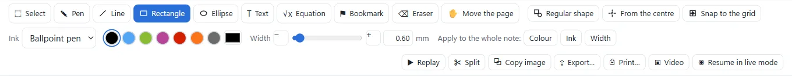

- **Regular shape**: a square, a circle; a line snaps to the nearest of horizontal, vertical or 45° diagonal. The `Shift`
  key, held during a stroke, inverts this button for that stroke.
- **From the centre**: the first point is the centre of the shape (a line grows both ways). The `Alt` key, held during a
  stroke, inverts this button for that stroke.
- **Snap to the grid**: the points you put down (the start and the end; for a rectangle or an ellipse, the corners of its
  box) snap to the page's paper: the intersections of **Squared 5 mm**, **Millimetre** and **Dotted** paper; the rules of
  **Ruled** paper (the horizontal only, the other way stays free); the rules and large squares of **Seyès** (not the thin
  rules). The button is greyed out, with the reason, on paper without lines (plain, music). If the shape must stay regular and
  the two ways do not have the same pitch (ruled paper), the regular shape wins.

The three settings are kept while Ardoise is open, from one note to the next, and come back off at the next launch. A shape
is an ordinary stroke: a rectangle or an ellipse is one closed stroke (the partial eraser can open it); the eraser, the
lasso, **Undo**, the layers, the replay and every export treat it like any other stroke. These tools are not in live mode
with a tablet.

### Typing text

The **Text** tool (the `T` key) puts on the page a frame where you type with the keyboard: tap or click the page where you want
it (with the pen, the mouse or a finger; on a touch screen, Windows offers its on-screen keyboard), then type. The text is drawn
as you type, as it will be exported. `Enter` starts a new line; a line never runs on to the next by itself: the frame widens
with what you type. `Esc` (or a click elsewhere, or another tool) ends the typing: the text stays, and the frame is selected.
A frame left empty goes away. The whole typing is undone by one `Ctrl + Z`. While you type, the keys go to the text, never to
the editor's shortcuts.

To change a text, tap it with the **Text** tool, or double-click it with the **Select** tool: the cursor goes where you tapped.

Under the toolbar, with the **Text** tool or when texts are selected:


- **Font**: **Latin Modern** (the font of LaTeX) or **Andika** (a font designed for learning to read). Both come with
  Ardoise: the text is the same on every computer and in every export. The Greek letters Latin Modern lacks are taken from
  Andika (not all of them: α, β, γ, δ, θ, λ, μ, π, ρ, σ, φ, χ, ω, Δ, Ω, among others).
- **Size**: **Small** (4 mm), **Medium** (6 mm) or **Large** (9 mm).
- **Bold**.
- The colour is the tool's: choose it among the toolbar's colours.

These settings apply to the whole frame (no formatting inside a frame): to the frame you are typing, else to the selected
texts, and to the next frames. Clicking these buttons does not end the typing.

A text lives with the strokes: it is selected with the lasso, moved, resized (it grows or shrinks with the strokes; choosing a
size gives it that size again), duplicated, copied and pasted, deleted, turned with the page, put on the chosen layer and
follows its layer. The eraser does not erase it: select it and delete it. It appears at once in the replay and in videos, at
the moment it was put down, and is in every export (images, SVG, PDF, clipboard, printing, projection, network share; in the
PDF it can be searched and copied). The library's search finds it. The **Text** tool is not in live mode, but a sheet resumed
in live mode keeps its texts.

### Writing an equation

The **Equation** tool (the `M` key) puts on the page a formula written in LaTeX, in math mode, as between `$…$` in a LaTeX
document: tap or click the page where you want it (with the pen, the mouse or a finger). A panel opens next to it: type the
code in **LaTeX code**; the **preview** shows, as you type, what will be placed. **Place** (or `Enter`, or `Esc` as for a
text) puts the equation on the page, where you tapped, and selects it; `Shift + Enter` starts a new line in the code. With an
empty field, `Esc` closes the panel without placing anything; with incorrect code, the panel stays open, the code and its error
in it, for you to correct it: nothing is lost. **Cancel** (or another tool) closes the panel without changing anything. Until
the equation is placed, the page does not change; once placed, one `Ctrl + Z` takes it away. While you type, the keys go to the code, never to the editor's shortcuts. The first time, the tool
takes a second to load.

If the code is not correct, the preview says so with MathJax's message (for example "Missing close brace" for a forgotten
brace) and the equation cannot be placed: nothing is corrected or guessed for you. Ardoise also refuses a character it cannot
draw (scripts other than Latin and Greek) and equation numbers (`\tag`).


A few examples:

| You type | For |
|---|---|
| `v = \dfrac{d}{t}` | an average speed (`\dfrac`: a large fraction, `\frac`: a small one) |
| `E_c = \dfrac{1}{2} m v^2` | a kinetic energy (`_`: subscript, `^`: superscript; `^{-3}` for several characters) |
| `\vec{F} = m\,\vec{a}` | vectors (`\,`: a thin space; `\overrightarrow{AB}` for a long arrow) |
| `\rho = \dfrac{m}{V} = 1.0\ \text{g}\cdot\text{cm}^{-3}` | a density with its unit (`\text{…}`: upright words, accents included) |
| `\Delta t`, `\alpha`, `\lambda`, `\Omega` | Greek letters |
| `\ce{2H2 + O2 -> 2H2O}` | a reaction (`\ce{…}`: chemistry, the numbers subscripted by themselves) |
| `\ce{Cu^2+ + 2e- <=> Cu}` | ions, electrons, an equilibrium |
| `\ce{CaCO3 -> CaO + CO2 ^}` | a gas given off (`^`), a precipitate (`v`) |
| `\pu{9.81 m/s^2}` | a value with its unit, well spaced |
| `20\,\celsius` or `5\,\ohm` | degrees Celsius, ohms |
| `\begin{cases} x = 1 \\ y = 2 \end{cases}` | a system (`\\`: next line) |

To change an equation, tap it with the **Equation** tool, or double-click it with the **Select** tool: its code comes back in
the panel; **Update** (or `Enter`, or `Esc`) draws it again in the same place (its top-left corner does not move). While its
panel is open, the equation stays selected: the colours and the sizes apply to it.

Under the toolbar, with the **Equation** tool or when equations are selected: the **Size**, **Small** (4 mm), **Medium** (6 mm)
or **Large** (9 mm), the height of a letter as for a text of that size; it applies to the selected equations and to the next
ones.

The **Colour** swatches of the toolbar (and **Choose another colour**) colour the whole equation: the one you are writing,
whose preview takes the colour at once while the cursor stays in the code, the one you are changing, and the ones you select,
alone or with strokes and texts (one `Ctrl + Z` per change of colour).

An equation lives with the strokes, like a text: it is selected, moved, resized, duplicated, copied and pasted, deleted, turned
with the page and follows its layer; the eraser does not erase it. Ardoise draws it itself in every export (images, SVG, vector
PDF, videos, clipboard, printing, projection, network share), and it appears at once in the replay, at the moment it was
placed. The note keeps its code: the library's search finds it ("H2O" finds `\ce{2H2 + O2 -> 2H2O}`), the assistant reads it.
This is not full LaTeX: only math mode, `\ce` chemistry and the common commands (`amsmath`, `\cancel`, `\boxed`,
`\celsius`…). The **Equation** tool is not in live mode, but a sheet resumed in live mode keeps its equations.

### Putting bookmarks

The **Bookmark** tool (the `B` key) puts on the page a small marker holding a word or a short phrase: tap or click the page where
you want it (with the pen, the mouse or a finger), then type the text in the field that opens under the bookmark. The bookmark is
drawn as you type, with a small flag. `Enter` or `Esc` (or a click elsewhere, or another tool) ends the typing: the text stays and
the bookmark is selected. An empty text removes the bookmark. The text is one line (60 characters at most). The whole typing is
undone by one `Ctrl + Z`, and the keys you type never trigger the editor's shortcuts.

To rename a bookmark, tap it with the **Bookmark** tool, or double-click it with the **Select** tool. To move it, select it (a
click, or the lasso) and drag it; **Delete** removes it; it is duplicated, copied and pasted like a text.

Bookmarks are **for the editor**: they show on screen, but are **not in the image exports (PNG, JPG, WebP, SVG), the videos, the
replay, printing, the projection or the network share**. They are used for three things:

- **the summary of the binder** (see **The summary of a binder**, chapter 7);
- the library's **search**, which finds a note by the text of its bookmarks;
- **the PDF's bookmarks**: the PDF of a binder (**Export the binder as a PDF…**) has, under each note's bookmark, that note's
  bookmarks, which lead to their spot on the page; the PDF of a single note has its bookmarks as its outline.

No layer hides a bookmark: it stays visible, selectable and in the summary even when its layer is hidden. "Back to the original"
does not remove it (a bookmark is not ink). A note that holds only bookmarks is still an empty page for the export.

### Straightening shapes

Select strokes, then **Straighten shapes** (or the `F` key): lines, circles, ellipses, rectangles (even rotated) and
arrows drawn freehand become clean shapes, with the same tool, colour and width. The writing and anything that is not
a clear shape do not change. Ardoise straightens lines and arrows at least 1 cm long, and circles, ellipses and
rectangles at least 1.3 cm across; a small upright oval (under 2.5 cm) looks like an "O" or a "0" and stays as it
is. Select the drawings rather than the text. A single undo cancels it all (`Ctrl + Z`).

**Setting the straightening.** The small button to the right of the **Straighten shapes** button (**Straightening settings**, a settings icon) opens a panel with three
settings:

- **Tolerance**: from **strict** to **lenient**, in five steps. Lenient also straightens shapes drawn less clearly;
  strict, only the clearest ones. The middle step, **normal**, is how it worked before.
- **Minimum size**: from 5 to 25 mm (10 mm to begin with). A line or an arrow must be at least that long, a circle, an
  ellipse or a rectangle 3 mm more. Below 1 cm, letters may be straightened: select only the drawings then.
- **Automatic alignment**: two boxes, each with its slider. The first makes a stroke that is nearly horizontal or
  vertical exactly so (up to 4° to begin with, from 1° to 10°); the second makes a circle or a square of a nearly round
  or square shape (within 10% to begin with, from 2% to 20%). With a box unticked, the shape stays as you drew it.

While the panel is open and strokes are selected, the page shows in **dashed blue** what would be straightened (the
original strokes fade), and the panel tells how many shapes are recognised: move the sliders to see shapes appear or
disappear. Nothing changes in the note until you click **Straighten** (or the **Straighten shapes** button, or press
`F`); `Ctrl + Z` undoes it as usual. `Esc` or a click elsewhere closes the panel without straightening anything, and
the values you chose stay. **Default values** puts back the ones from before the setting existed.

The values are kept for every note (and the assistant straightens with the same ones). The panel never goes past the
bottom of the window: in a low window it scrolls with the wheel or a finger, and its buttons stay in sight at the
bottom. A small upright oval (an "O", a "0") is never straightened, whatever the setting.

### Copy and paste

`Ctrl + C`, `Ctrl + X` and `Ctrl + V` (or the buttons of the **Selection** block) copy, cut and paste strokes, texts and bookmarks
*from one note to another*, from one window to another, through Windows' clipboard. Pasted strokes keep their colour, tool
and width, texts their font, size and colour; they are replayed last. Anything that does not come from Ardoise is ignored.

The **right click on the page** (with the mouse: not with the pen's button, which lassoes, nor with a finger) opens a menu of the
same commands. With the **Select** tool, the stroke or text under the pointer is selected first if it is not already; an
existing selection stays as it is when the pointer is on a part of it.

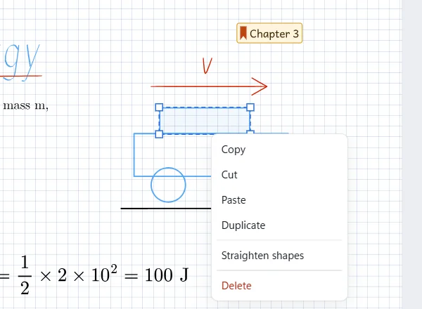

With a selection: **Copy**, **Cut**, **Paste**,
**Duplicate**, **Edit** (one text, one equation or one bookmark only), **Straighten shapes** (when strokes are selected) and
**Delete**. Without a selection: **Paste**, **Select all**, **Undo** and **Redo**. **Paste** is always offered: if the clipboard
holds nothing from Ardoise, a message says so. Nothing during a replay or with the split panel open.

### The sheet: paper, template, format, orientation

The **Page** tab of the side panel sets up the sheet:

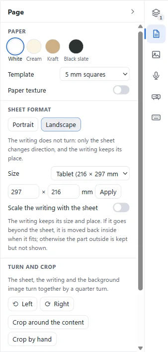

- **Paper**: four colour swatches, **White**, **Cream**, **Kraft**, **Black slate** (and **Custom** when the note has a
  paper of another colour); **Template**: **Blank**, **Lined**, **Seyès**, **5 mm squares**, **Graph paper (mm)**,
  **Dotted**, **Music staves**; **Paper texture** switch.
- **Sheet orientation**: **Portrait** or **Landscape**. **The writing does not turn**: only the sheet changes direction,
  and the writing keeps its place (if it goes beyond, it is moved back inside the sheet when it fits; otherwise the
  part outside is kept but not shown, and a message says so).
- **Sheet format**: **A4**, **A5**, **Letter**, **Tablet** (216 × 297 mm, the Bamboo Slate's page) or **Custom** (width
  and height in millimetres, then **Apply**). **Scale the writing with the sheet** shrinks or enlarges the writing and
  the background image with the sheet, without distortion.
- **Turn the sheet with the writing** (**Left** or **Right**): a quarter turn of everything together, like turning a
  sheet of paper.
- **Crop around the content** (automatic) and **Crop by hand** (draw the rectangle to keep).

### Background image or PDF

In the **Background** tab of the side panel, the **Background image or PDF** section puts an image (PNG or JPEG) or a PDF page *under* the
writing, to annotate a worksheet, a document or a photo: **Choose a PDF or an image…**, the PDF page if needed, then
**Put in the background**. For a PDF of several pages, Ardoise shows a **thumbnail of each page**, its number under it,
so that you can tell which one you need: click the thumbnail you want (the first is chosen to begin with, the chosen
page is framed), or, with the keyboard, `Tab` to enter the list, the arrows to move from page to page (`↑` and `↓` by a
row, `←` and `→` by a page), `Home` and `End` for the first and the last page. The thumbnails are drawn as they come
into view, so a PDF of several hundred pages opens at once; from eight pages, a **Page** field takes you straight to a
number. A page that Windows cannot draw can still be chosen: its thumbnail says "Preview unavailable". Set the **Placement** (**Whole**, **Fill the page**, **Stretched**) and the **Opacity**;
**Replace…** changes the file, **Remove the image** removes it, **Turn the image alone** turns the image without
touching the sheet or the writing. If the image does not have the note's orientation, Ardoise offers to switch the note
to the image's orientation. Everything can be undone. The image follows rotations, splits and assemblies and appears in
thumbnails, exports and videos. PDFs are rendered by Windows.

### Layers

The **Layers** zone, in the **Layers** tab of the side panel (open at the start), lists the page's layers, the highest first. A layer is a
transparent sheet laid over the others: a tablet's writing, your annotations, a correction.

- **Choosing a layer**: click its row, which gets a frame. **The pen, the eraser and the selection act only on the
  chosen layer**: the lasso, the click, `Ctrl + A` (**Select everything**) and the eraser take only its strokes, and what
  you draw, paste or duplicate goes onto it. To touch the ink of another layer, choose it first. Choosing another layer
  clears the selection. When a note opens, the chosen layer is the highest of the shown layers.
- **Showing or hiding**: the *eye* at the start of the row; it is *crossed* when the layer is hidden, and its name turns
  grey italic. A hidden layer is neither drawn on screen nor exported (chapter 10).
- **Renaming**: the *pencil* after the name. Type the name, `Enter` keeps it, `Esc` gives the old one back (clicking
  elsewhere keeps it too); an empty name changes nothing.
- **Move up**, **move down**, **merge into the layer below**: the **↑**, **↓** and **⤓** buttons, on the chosen row only.
- **Add a layer** (under the list) creates a layer at the very top and chooses it.
- **A warning** appears when the chosen layer is hidden: "The chosen layer, "…", is hidden: show it to write on it."
  While it is, the pen does not write, and the eraser and the selection find nothing there: show it, or choose another
  layer.

A **right click on a layer** chooses it and opens the menu of its actions: **Rename…**, **Hide** (or **Show**), **Move up**,
**Move down**, **Merge with the layer below** (and, in live mode, **Have the tablet write here**).

Adding, hiding, renaming, moving and merging are undone with `Ctrl + Z`. For layers during live mode, see **Correcting
during live mode** (chapter 6).

### Projecting the note on a video projector

*Does not need the tablet.* To show the class the note you are correcting or completing, without going through live mode:
in the **Projection** tab of the side panel, **Projector** block, choose the **Projection screen** (**Refresh the list of
screens** updates it) and click **Project**. As for live mode, plug in the projector and choose *Extend* in Windows
(`Win + P`) first. The editor's page appears full screen on the projector, with its paper, its background image and its
shown layers, and it is **updated at every stroke**: what you write with the pen, the mouse or a finger appears as you
write it.

- **What the class sees.** The stroke under way, then the result of each action: undo, redo, erase, move, resize, recolour,
  paste, straighten, a change of paper, image, sheet size or orientation, **Back to the original**. An eraser or a move
  being dragged only appears once released. The class *never* sees the selection, the lasso, the eraser's ring, nor the
  preview of a straightening, a split or a crop. A hidden layer is not projected.
- **The projected area.** The **Projected area** block sets the zoom: **Whole page** (the default), **Width** (the page
  across the whole width of the projector), **Zoom in** and **Zoom out**. The area is *centred on what the editor shows*,
  and a **dashed frame** in the editor shows it on the page. So you can zoom the editor in to write small while the class
  keeps its zoom; scrolling the editor moves the projected area.
- **A window that shows only the page**: no blackboard, no laser pointer, no marks over it (the editor is where you
  write).
- **The replay** (chapter 9) is projected too, as the editor shows it.
- **Another note** (`Alt + ←` and `Alt + →`): the projection stays open and shows the other note. It stops when you leave the
  editor (back to the library, resuming live mode, closing the window).
- **Stopping**: **Stop projecting**, or `Esc` in the projected window (`Ctrl + W`, `Ctrl + F4` and `Ctrl + Q` close it too).
  The tab and the blue dot of **Projection** follow. With a single screen, the window covers the editor: `Esc` closes it.
- **One projected window at a time**: projecting the editor closes the projection of live mode, and the other way round.
- **Network sharing** (the **Network sharing** block, same tab) can run at the same time: the other computer shows the
  whole note, not the zoomed area, with a slight delay.
- The assistant does not drive this projection, and no key starts it.

### Splitting a note

**Split** detaches part of the note into a new note, either:

- **At an instant**: drag the **Instant of the split** along the timeline; everything written from there on moves to the
  new note (suggested title: "… (continued)"). The strokes concerned are coloured.
- **By zone**: draw on the page, like with the lasso, the zone to detach (suggested title: "… (excerpt)").

Ardoise tells you how many strokes stay and how many go, and lets you change the **Title of the new note**. Each note
must keep at least one stroke.

### Back to the original

For a note received from the tablet, **Back to the original** (**Page** tab, **Original** block) restores the ink as it
arrived, without your edits. Ardoise spells out what is lost (strokes added, erased, moved, layers, rotation, format)
and what stays (title, tags, favourite, paper, narration, background image). The action can be undone (`Ctrl + Z`); then
save to keep it. For a note that has never been modified there is no original yet: Ardoise keeps the previous version
the first time you save a change of the ink, or the time live mode resumes the sheet and writes on it (see chapter 6).
The original is always the *first* version of the note, never the state just before the last change.

### A copy retouched by an assistant

When your assistant (chapter 14) retouches a note, it never writes the original's ink: it makes a **copy** next to it,
which Ardoise recognises. Open that copy: under the top bar, a line says **Retouched copy of "Title"** ("Untitled
note" if the original has no title), with three buttons.

- **Open the original** opens the note it was made from in the editor, like the "Previous page" and "Next page" arrows
  (with unsaved changes, Ardoise first asks what to do with them). The button is greyed, with "The original is not in
  the library", when Ardoise cannot find it: it may be in the trash (**restore it from the trash**), not synchronised
  to this PC yet, or unreadable here.
- **What changed** opens the assistant's account: one dated line per retouching, with every change and every letter it
  made. It is a text written by the assistant, which can be wrong: look at the copy.
- **Compare** shows the original and the copy side by side (one above the other in a narrow window). The copy is shown
  as it is saved: its unsaved changes are not in it. Greyed as well when the original is not in the library.

**Two senses of "original".** **Open the original** and **Compare** show the note it was made from *as it is now*: if
you edited it after the copy was made, **Compare** shows those edits too. **Back to the original**, on the copy,
restores something else: the *first* ink of that note (for a note from the tablet, the page as the tablet sent it),
which may be neither today's original note nor the retouched copy.

A retouched copy is a note like any other: you can edit it by hand, rename it, export it, print it, resume it in live
mode (to project it) or delete it, which means **Move to trash** (from where you can restore it). Putting the
*original* in the trash does not touch the copy: it stays, and its two "original" buttons are greyed. What you can ask
the assistant, what Ardoise guarantees and what is only asked, is all in the guide [The assistant](assistant.en.md).

## 9. Replay, narration and video

### Replay

The **Replay** button (or the `R` key) replays the stroke *as it was written*. The page is not modified.

- **Play** / **Pause** (`Space`), and the **Position in the replay** timeline (the arrow keys move forward or back by
  one second when it has focus).
- **Speed**: from 0.25× to 16× (0.25; 0.5; 1; 2; 4; 8; 16).
- **Remove dead time**: pauses longer than half a second between two strokes are shortened to half a second.
- `R`, `Esc` or the button leave the replay.

Touch screens work as in the editor: one finger scrolls, two fingers zoom.

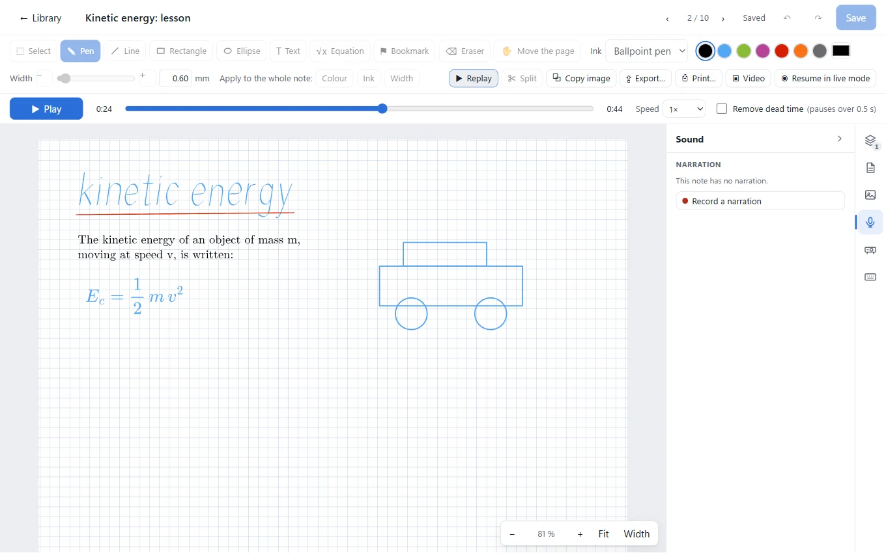

### Narration

A note has *a single narration*, a sound stored *in the note*. The **Sound** tab of the side panel says what the note holds
("Narration saved in the note (…)" or "This note has no narration.") and, outside a replay, offers two ways to record
it, chosen with the **Record the sound** control (the choice is remembered on this PC): **While I write**, the default, and
**During a replay**. In both, choose the **Microphone** (the list remembers your choice on this PC; **Refresh the list of
microphones** if you have just plugged one in) and look at the **Microphone level** before starting: **Start**, then
**Stop and save**.

**While I write** (*does not need the tablet*). You talk *while writing in the editor*, with the pen, the mouse or a
finger (if **Draw with a finger** is on in **Settings**). The strokes written during the recording take the time of the
sound and are replayed with it, at the rhythm you wrote them, silences included, **after** the strokes the note already
holds.

1. In the **Sound** tab, choose **While I write**, open **Record while writing**, choose the microphone.
2. **Start**. If the note already has a narration, Ardoise first asks: "This note already has a narration (…). Replace it
   with this new recording?" with **Replace** or **Keep the old one** (nothing is then recorded). The same question is
   asked in the **During a replay** mode (which used to replace by merely saying so).
3. Talk and write: "Write: your strokes follow the sound." A red dot marks the **Sound** tab.
4. **Stop and save**: the note is *saved at once*, with the sound and what you wrote ("Sound saved (…) with your
   strokes."). **Cancel** throws the sound away and *keeps the strokes*. If saving the note fails (it changed on another
   PC), the sound stays in memory ("The sound is kept in memory…"), the usual banner offers to reload or to **Save as a
   copy**, and the copy gets the sound too. Reloading the note, or choosing not to save it, drops that sound.

What happens during the recording:

- `Ctrl + Z` and `Ctrl + Y` make a stroke go and come back with its time, without touching the sound; the eraser, a move,
  a change of colour and deleting do not change the strokes' times. A *pasted* stroke appears at the instant you pasted
  it, with the rhythm it had.
- Leaving the editor, switching notes, resuming live mode, closing the window, starting a replay, **Back to the
  original**, splitting and exporting the video are refused with "Stop or cancel the narration recording first." Everything
  else works as usual.
- If nothing is written, the sound is saved alone, after the ink: a commentary. If Windows blocks the microphone
  (silence), Ardoise says so and keeps no sound; the strokes stay.
- After the recording, a stroke written later is placed *after the end of the sound*, so that it does not appear during the
  narration.

*One thing to know.* **Play with narration** replays this sound at normal speed, without cutting dead time: if the note
already held writing done in class, its real pauses are replayed before the voice starts, in the replay and in the video.
Without the narration, the replay is unchanged.

**During a replay.** **Record a narration** (in the **Sound** tab, which opens by itself with the replay) lets you talk
while the stroke is drawn. The narration follows the replay's speed and dead-time setting at the moment you start it.
**Start the replay** (in the **Sound** tab, outside a replay) starts it. *Save the note (`Ctrl + S`) first*: the sound is
added to the note as it is on disk.

In both modes, **Play with narration** replays stroke and sound together, and **Delete the narration** removes it.

If Windows blocks the microphone you get silence and Ardoise detects it: open *Settings > Privacy & security >
Microphone* and turn on *Let desktop apps access your microphone* (a microphone mute switch, on some PCs, gives the
same result).

In live mode, **Record the narration** records the sound during the session, cut page by page.

### Exporting as video

The **Video** button opens **Export as video**. Four formats:

| | **MP4 (video)** | **Animated GIF** | **Animated WebP** | **WebM (video)** |
|---|---|---|---|---|
| Plays with | Everything: Windows, phone, PowerPoint, school intranet | Browser, email, slide: no player needed | Recent browsers and software | Browsers, Moodle, VLC |
| Sound (narration) | Yes | No | No | Yes |
| Transparent background | No | Yes | Yes | No |
| File size | Small | Large | Medium | Small |
| Export time | Fast | Very fast | Long | The longest |

When in doubt: MP4, which plays everywhere and carries the sound; GIF for a short animation that must show without a
player.

Settings: **Image size** (**720p**, **1080p**, **4K** or **Page size**), **Frames per second** (10, 15, 24, 30 or 60),
**Length of the video** (a **Speed** or a **Target duration** in seconds), **Remove dead time**, **Background**
(**With the paper** or **Transparent**), **Freeze the last frame** (0 to 60 seconds), **Include the narration**. The size,
the length and the *estimated export time* are shown before you start; **Export…** then asks for the file to create, a
bar shows progress and **Cancel the export** stops it. The file only appears once it is complete. WebM (AV1
compression) is much slower: reduce the size or the number of frames per second if the estimate is long.

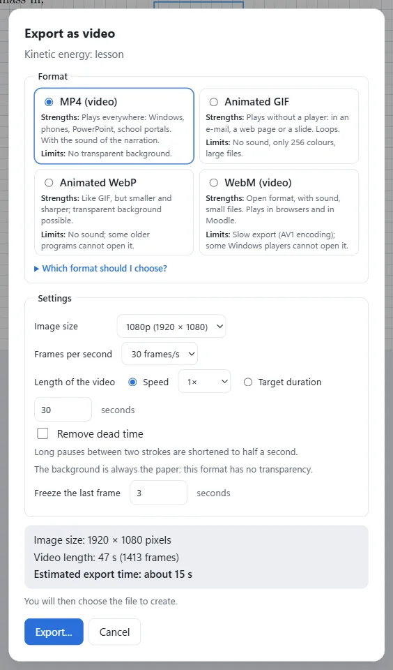

*MP4 on a Windows "N" edition.* Ardoise writes MP4 with the encoder built into Windows. It is missing on "N" editions
installed without the *Media Feature Pack*. In **Settings**, the **Backup video encoder (OpenH264)** section then lets
you **Download from Cisco** the OpenH264 encoder (the file comes from Cisco's server and its fingerprint is checked; the
licence is shown; **Cancel the download**, **Remove** and the **Allow Ardoise to use OpenH264 for MP4 files** box keep
you in control). This download only happens if you ask for it; OpenH264 is never shipped with Ardoise. Without it,
choose WebM. With this backup, the MP4's sound is Opus: playable in browsers and VLC, but not in the Windows media
player.

## 10. Exporting, printing, sharing

### Exporting a note or a selection

**Export…** (editor toolbar, or the selection bar in the library for several notes) opens the **Export** window with the
question **Which format should I choose?**:

| | **PNG (image)** | **JPG (image)** | **WebP (image)** | **SVG (vector)** | **PDF** |
|---|---|---|---|---|---|
| Sharp when enlarged | No | No | No | Yes | Yes |
| Transparent background | Yes | No (white background) | Yes | Yes | No |
| Several notes in one file | No (one file per note) | No | No | No | Yes (one page per note) |
| Opens with | All software | All software | Browsers, Windows 11, recent software | Browser, Inkscape, recent Word | Any PDF reader |
| Best for | Word, OneNote, slide | A site or form that requires a JPG | Web page, messaging | Retouching the drawing | Printing, sending, archiving |

When in doubt: the **PDF** to print or send a note, the **PNG** to insert it in a document.


Settings: **Resolution** (**96 dpi (screen)**, **150 dpi (usual)**, **300 dpi (print)**), **JPG quality**, **PDF page**
(**The page's actual size** or **A4 (note fitted and centred)**), **Include the background** (unticked, only the stroke
is exported). Ardoise then asks for the file to create (or the folder, for a one-file-per-note export: no existing
file is overwritten). Resolutions that would give an image more than 16,384 pixels on a side are not offered; use the
PDF or the SVG then. The SVG keeps the stroke's width according to pressure.
All formats draw the strokes exactly as the screen does. For the note's layers, see just below.

### Layers in exports

When a note has at least two shown layers that hold ink, the **Export** window shows, for the **SVG** and the **PDF**, the
**Layers** choice:

- **Separate**: one layer of the file per layer of the note. In an SVG they are Inkscape layers, to show or hide in
  Inkscape. In a PDF they are PDF layers, to show or hide in Acrobat Reader or Firefox (their layers panel); some readers
  show them all, with no choice, and a reader that does not handle PDF layers draws everything. In a PDF of several notes,
  layers of the same name make a single switch for all the pages.
- **Merged**: one drawing, as on screen.

To begin with, the SVG is on **Separate** and the PDF on **Merged**. Ardoise remembers the last choice, for each of the
two formats.

- **An image** (PNG, JPG, WebP) has no layers: they are always merged. The window says so when a note has several
  layers.
- **A hidden layer is never exported**, even in **Separate**: it may hold the answers. The window reminds you when a
  note has a hidden layer that holds ink.
- The automatic export for the phone, **Print…** and **Copy image** have no such choice: their layers are merged, as
  before.

### The text of the handwriting

At the bottom of the same window, **Recognised text (handwriting)** gives the handwriting as read by Windows:
**Save as .txt…**, **Save as Markdown…**, **Save as Word…** or **Copy the text**. Markdown and Word keep the structure:
title, date and tags at the top, then paragraphs, lists and drawings (images). A preview is available. If Windows
could not analyse the layout, Ardoise says so: the structure is then guessed from the text and may be less accurate.
*Always read the text over*: recognition can make mistakes.

- *The words are the same* in the .txt, the Markdown, the Word file and the copied text: they are those of the
  recognition of the whole note. Windows' layout analysis only supplies the structure (paragraphs, lists, drawings).
- *Corrections win.* If a corrected text has been saved for the note (by the assistant, chapter 14), that is what is
  exported, everywhere, instead of the recognised text.
- *A line under words* underlines them: it becomes **bold** in Markdown (which has no underline) and a real underline in
  Word. A line struck through words strikes them (`~~word~~` in Markdown, struck text in Word). These lines are not
  exported as images.
- **Include the drawings (Markdown, Word)**: diagrams and figures are placed as images between the paragraphs (in Word,
  inside the document; in Markdown, as PNG files in a folder next to the `.md` file, never replacing an existing file).
  A drawing next to a paragraph comes after it. The box is ticked only if the notes have drawings; otherwise Ardoise
  says "No drawing found: the text alone is exported". Untick it to get the text only.

### Copying, printing, dragging

- **Copy image**: puts the note on Windows' clipboard; paste it into Word or OneNote.
- **Print…** (editor, or the selection bar; `Ctrl + P` does the same, see chapter 17): Ardoise's print window opens,
  then Windows' to choose the printer. Each note is printed on a page, in its orientation. You set **Print the background**, the **Size on the sheet** (**Real size** or
  **Fitted to the sheet**) and the **Notes per sheet**: **1**, **2 per sheet** or **4 per sheet**. With 2 or 4, Ardoise lays
  the notes out in order on the sheet, each in its own cell and undistorted (two portrait notes side by side on a landscape
  sheet, two landscape notes one above the other; four notes two by two); this setting is Ardoise's own, not the printer
  driver's (which would only act on sheets that are already made). In the Windows window the *pages* are then the sheets: five
  notes at two per sheet make three pages.

  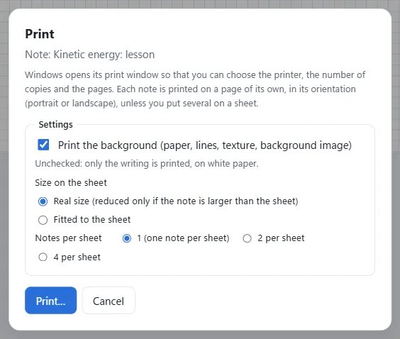

- *Dragging out of Ardoise*: the handle of a library card drops a *PNG image* of the note into Explorer, onto the
  desktop, into Word, OneNote or an email (one image per note if several are selected). Keep the button pressed while
  the image is prepared.

### Exporting or printing a binder

**Export the binder as a PDF…** (the **⋯** menu or a right click on a binder of the sidebar) puts all its notes in a single
PDF, one page per note, **in the binder's order** (**Binder order**, above), whatever sort is shown. The window is the export
window reduced to PDF, with the **Include the sub-binders** box (unchecked at first; it only appears if the binder has
sub-binders); their notes come after the binder's, each sub-binder in its own order. **A binder with no notes of its own**, only
in its sub-binders, has the box ticked from the start, and the window says so; unticked, there is nothing to export: the
**Export…** button waits and a sentence says what to tick. A binder with no note at all shows "This binder has no notes." and the
button stays greyed.

The PDF has **bookmarks** that the **In the summary** group sets (the same three choices as the binder's
summary, see **The summary of a binder**): the name of the sub-binders, a line per note (its title, or **Untitled note**, or its
date), and the **bookmarks put in the notes** (**Bookmark** tool), which lead to their spot on the page; open your PDF reader's
bookmarks panel to see them. Without the notes, the page bookmarks come right under the name of their sub-binder. If the choices
leave nothing, the PDF has no bookmarks (the sentence "the summary would be empty" says so).

The **Add a summary page at the start** box (unchecked at first, and remembered) puts a **summary page** at the head of the PDF:
the binder's name, then what you chose in **In the summary**, with the **page numbers** and dot leaders, like a book's; a long list
takes several pages, and the numbers count them. Each line is a **link** to its page (or to the bookmark's spot), and the PDF has a
**Summary** bookmark first. The page is A4 portrait if you chose the A4 page, else the size of the first note. If the choices leave
nothing, the box is greyed. To have it on paper, print that PDF (**Print the binder…** adds no summary page: the page numbers would mean nothing with several
notes to a sheet).

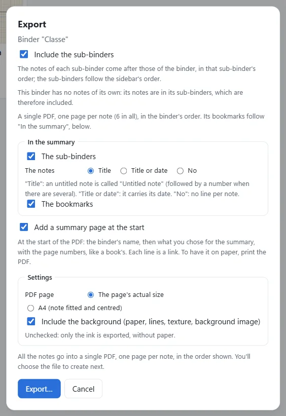

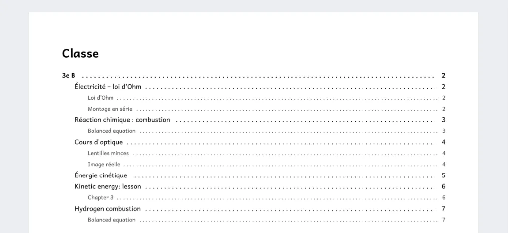

**Print the binder…** opens the print window with the same notes in the same order, the same **Include the sub-binders** box
(ticked from the start for a binder with no notes of its own) and the same sentences; the printed page carries no date or bookmark,
so there is no choice for the summary.

### Showing the live sheet

To have the sheet (or the open note) appear in the browser of another computer of the network, with no file to send:
**Share on the network** (**Projection** tab of the side panel), see the end of chapter 6. To show the open note on a
video projector plugged into the computer, use **Project** in the same tab (chapter 8, **Projecting the note on a video
projector**).

## 11. Importing your Inkspace notes

If you have used Wacom Inkspace on this PC, Ardoise can take over its notes. Ardoise changes and deletes nothing in
Inkspace: it only reads its data.

### From the application

1. Close Inkspace if it is open (if Ardoise cannot read its files, it tells you: "close Inkspace then try again").
2. In the library sidebar, click **Import from Inkspace…**. (At the first start, the window opens by itself if you left
   the Inkspace box ticked, chapter 3.)
3. The **Import from Wacom Inkspace** window looks for Inkspace on this PC ("Looking for Inkspace on this computer…").
   When it finds it, it shows **Inkspace's folder** and the number of notes ("24 notes found"), saying how many were
   *already imported* (in the library or its trash: they will be skipped) and how many cannot be read.
4. If Inkspace is not found ("Ardoise did not find Wacom Inkspace on this computer…"), or if you want to import from a
   copy (on a USB stick, for example), click **Choose a folder…** (or **Choose another folder…**) and give Inkspace's
   `LocalState` folder, or a copy of that folder.
5. **Destination binder**: "Inkspace" by default. Type another name, or pick an existing binder from the list offered;
   left empty, the field puts the notes at the root of the library.
6. Click **Import N notes**. A progress bar says "Importing notes: 3 of 24…". **Stop the import** stops after the note in
   progress: the notes already imported are complete, and running the import again adds the others.
7. A report appears (**Import finished**, or **Import stopped**): how many notes were imported and into which binder,
   how many had been imported before (skipped), and the notes that could not be imported, with their date, the start of
   their identifier and the reason. **Show the imported notes** opens the binder.

Importing several times creates no duplicate: a note already imported is skipped, even if you renamed it, moved it or
put it in the trash.

### On the command line

The same import exists without a window: in PowerShell, in the folder of `ardoise.exe`,

```
.\ardoise.exe --import-inkspace --library "C:\Users\Name\Nextcloud\Ardoise\Notes" | Out-String
```

(`| Out-String` makes PowerShell wait and shows the report at the end; add the `LocalState` folder of a copy as the first
argument if Ardoise cannot find Inkspace.) Without `--library`, it only shows the table of the notes found. The report,
in French, ends with "N/N notes importées".

### Good to know

- Inkspace does not keep the *pressure* but the stroke's width: Ardoise estimates the pressure from the width. The look
  is very close, but not identical.
- Inkspace does not always keep the *timing* of the writing: when it is missing, Ardoise makes it up (the "synthétisé"
  column of the command-line report), and the replay of those notes is only indicative.
- Imported notes use the *ballpoint pen*, on a white background, with no title or paper; you can edit them like any
  others.
- Wacom's cloud and Inkspace's collaboration do not exist in Ardoise: only the notes present on the PC are taken over.

## 12. Pen and touch screen

On a PC with a touch screen and a pen (a Surface, for example), the editor, the replay, the live mode preview and the
presentation can be used with the pen or a finger.

*The pen*

- The stroke *gets thicker with pressure*.
- The *back of the pen* (the eraser) *erases*, with the eraser settings (**Whole strokes** or **Partial**), whatever the
  tool chosen. An eraser circle appears when it hovers over the page.
- The pen's *button* draws a *selection lasso*, whatever the tool. Afterwards, the pen's *tip* (like a finger) grabs the
  selection instead of drawing: put down inside the frame, it moves it; put down on a handle, it resizes it (with the
  **Pen** and **Eraser** tools). Outside the frame, it draws as usual.
- A *palm* resting on the screen is ignored while the pen is in use or near the screen.
- In the *live mode* preview, the **Pen** tool (`P` key) writes with the pen on the chosen layer, and the back of the pen
  erases whole strokes of that layer: see **Correcting during live mode** (chapter 6). A finger there only moves the
  projected area.

*The finger*

- By default, *a finger does not draw*: it *scrolls* the page, *two fingers zoom* around themselves, a *double tap*
  fits the whole page.
- For a touch screen without a pen, tick **Draw with a finger** (in **Settings**, **Pen and touch** section, or the
  **Finger** box of the zoom bar): the finger then draws like the mouse, and two-finger zoom still works. This setting
  is specific to each PC. With the **Move the page** tool, or in a replay, a finger always scrolls.

*The back of the pen and the button cannot be simulated by the automated tests; the author has tried them by hand on a
Surface.*

## 13. Diagnostics and trials with the tablet

*Needs the tablet.* If something does not work with the tablet, or to check an installation, Ardoise can test itself and
keep a trace of what it exchanges with the tablet.

### Testing the tablet

Click **Test the tablet** (at the bottom of the sidebar, or in **Settings**). The **Tablet test** goes through eight
steps: **Bluetooth adapter**, **Reference pages**, **Finding the tablet**, **Connection**, **Information**, **Page
download**, **Live mode**, **Reconnection**. It takes about 5 minutes; click **Start the test**, follow the on-screen instructions, click **Done,
continue** after each action, **Skip this step** if a step is stuck, **Stop the test** to finish. For the reference
pages, draw: a square and a circle as large as possible; "Ardoise 2026" in normal handwriting; three horizontal
lines, very light, normal, very heavy.

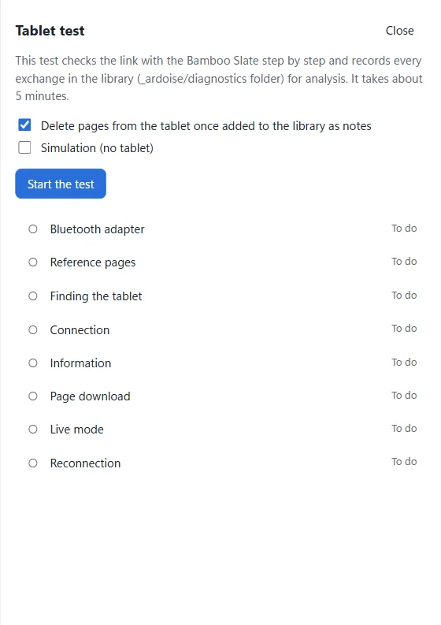

Two boxes to know about: **Delete pages from the tablet once added to the library as notes** (ticked by default) and
**Simulation (no tablet)**. The test may register the tablet if it is not yet registered, with the same consequences as in chapter 4.

> *Beware of the pages already on the tablet.* During the test, the pages in memory are downloaded, then deleted
> from the tablet if the box is ticked. Each page is first saved and checked: a raw copy is kept in the diagnostics
> folder (see below) and the page is added to the library as a note, as in the normal sync (a page already there is not
> added twice). Only then does the tablet delete it; if a page cannot be saved, it stays on the tablet. If the tablet
> holds important pages, you can also get them first through the normal sync (chapter 5).

At the end, the summary says "N passed, N failed, N skipped" and gives the location of the log.

### Where the logs are

Each Bluetooth exchange is noted (time, direction, bytes, interpretation) in the library, in `_ardoise\diagnostics\`:
`YYYY-MM-DD_HHMMSS.jsonl` (the complete log), `.txt` (the readable report) and, for each page received, a raw file and an
SVG preview. A log is also written automatically when a connection fails. *As this folder is in the library, Nextcloud
brings it back to the other PC by itself*: you have nothing to send by hand. These logs contain the exchanges with the
tablet, so the pages it sent during the test; they do not contain the rest of your library.

### Trials on the hardware

The project's repository contains `docs/hardware-tests.md`, the detailed list of the trials to make with the real
hardware (the executable on the work PC, the tablet, sync, live mode and the projector, pen and touch). The *self-test*
checks the settings, WebView2, the interface, the translations and the presence of Bluetooth:

```
.\ardoise.exe --self-test | Out-String
```

Its last line is `SELF-TEST OK` or `SELF-TEST FAILED`, and the report is also written next to the settings.

## 14. The assistant (Claude Code, Claude Desktop)

Ardoise can be driven by *your own assistant* (Claude Code, Claude Desktop or any software compatible with the MCP
protocol): it reads your notes, sees them as images, tidies them up, titles them, files them, and can retouch a copy of
a note (tidier writing, redrawn diagram, corrected spelling) without ever changing the original. Ardoise itself contains no
AI and stays usable offline; it is the assistant's software that does the work.

**Settings**, **Assistant (MCP)** section, gives the exact text to copy into the assistant, with a **Read only** box so
that it can only read. Everything is explained step by step, with example requests, in the
[assistant guide](assistant.en.md) (en français : [L'assistant](assistant.fr.md)). The
**Open the "Assistant" guide** button, under the text to copy, opens it in your browser (in Ardoise's archive, it is the
file `guide\assistant.en.html`, and `guide\assistant.fr.html` in French).

## 15. Privacy

- Your notes stay in *your* folder, on your computers. Ardoise has no account and sends nothing anywhere.
- The only outgoing connection: the download of OpenH264 from Cisco, *only if you ask for it*. Ardoise does not listen
  on any network port, except during a network share that *you* started (chapter 6), which shows only the shared sheet
  and stops with Ardoise.
- Handwriting recognition is Windows', offline, and the recognised text stays in a cache local to each PC.
- Backup copies and caches are under `%LOCALAPPDATA%\Ardoise`, never in the library.
- The *diagnostic logs* are in the library (so in Nextcloud): put nothing personal there.
- If you use *an assistant* (chapter 14), what it reads goes to its provider according to your account settings. The text
  and image of your notes may contain pupils' names: think before entrusting it with pupils' notes, and prefer **Read
  only** when it only needs to read. The assistant never deletes anything for good (a deleted note goes to the
  trash).

### Licence and credits

**Settings** > **About Ardoise…** shows the version, the licence (free software, GPL-3.0 or later, with its full
text), the credit to the Tuhi project, Cisco's OpenH264 notice (and whether it is installed on this PC) and the list
of every component used, with its licence.

## 16. When something goes wrong

| What you see | What to do |
|---|---|
| Blue "Windows protected your PC" screen | Unsigned program: *More info*, then *Run anyway* (chapter 2). |
| Windows blocks `ardoise.exe` with no button to continue | A rule of your PC (Smart App Control, AppLocker…): ask your IT department for permission. |
| Empty window, or a window that does not open | WebView2 may be missing: install it from Microsoft's site. `.\ardoise.exe --self-test \| Out-String` says whether the engine is present. |
| "Cannot read the settings file…" | `ardoise.toml` is damaged or was edited by hand with a mistake. Ardoise does not overwrite it: fix or delete it, then restart. |
| "Bluetooth is switched off" | Switch it on in the Windows settings. |
| "No Bluetooth adapter found" | Plug in the Bluetooth dongle (4.0 or later), wait for Windows to recognise it, try again. |
| "The tablet does not answer" / "is not connected" | Bring it closer to the computer and press its button briefly; check the charge. |
| "The tablet refused the command" | The phone app or Inkspace may have registered it since: register it again in Ardoise (chapter 4). Turn off the phone's Bluetooth. |
| "This page of the Xiaomi tablet is not the same way round as the tablet is held…" | The page is wide and the position set is "upright" (or the other way round). Choose a position of the same way round as the page in the Xiaomi tablet's settings, hold it that way, then **Try again**; or resume live mode on another sheet. The note was not touched (chapter 6). |
| "This sheet cannot be continued with this tablet" | A Bamboo Slate sheet is continued with the Bamboo Slate, a page of the Xiaomi tablet with the Xiaomi tablet. Switch on the other tablet (the Xiaomi connects by itself, the Bamboo Slate needs a brief button press), then **Try again**; the note was not touched (chapter 6). |
| "The Xiaomi tablet sent a page that Ardoise cannot read" | That page was not imported and stays on the tablet, with the pages stored after it (the tablet gives only its oldest page). Import them with Mi Home, and keep the diagnostic log (`_ardoise\diagnostics\` in the library, chapter 13). |
| "The tablet is busy" | A sync or live mode is under way: try again when it is finished. |
| "No Xiaomi tablet found" | Switch it on, bring it close to the computer, close Mi Home (or turn off the phone's Bluetooth: it talks to one application at a time), then **Look again** (chapter 4). |
| The Xiaomi tablet no longer has its pages | Mi Home imported (and deleted) them before Ardoise: pages go to whichever application takes them first (chapter 5). |
| "The Xiaomi tablet's pages are imported only with your agreement" | **Delete from the tablet after import** is off: confirm the sync (**Sync and delete**) or turn the option on (chapter 5). |
| "A page of the Xiaomi tablet was not received in full" | The page stays on the tablet (except that of a screen that was not erased: see the "was not received cleanly" row below). Bring it closer to the computer and sync again. |
| "A page of the Xiaomi tablet could not be written in the library…" | The tablet no longer holds that page, but Ardoise kept a rescue copy (`_ardoise\rescued-pages\` in the library, or `%LOCALAPPDATA%\Ardoise\blackboard-rescue\` on this PC) and will import it at the next sync of the Xiaomi tablet. Check that the library can be reached and has room left, then **Sync** (chapter 5). |
| "A page of the Xiaomi tablet could be written neither in the library nor on this PC…" | Ardoise keeps the page in memory and will try again at the next sync. **Do not close Ardoise** until then; make the library reachable or free some room, then sync again (chapter 5). |
| "A page of the Xiaomi tablet was not received cleanly…" | What came is kept apart, without a note, in `_ardoise\rescued-pages\doubtful\` of the library. If a note of that page was made, check it, and keep the diagnostic log (chapter 13). |
| "The Xiaomi tablet still holds 2 stored pages…" (window) | Live mode does not start until those pages are imported: **Import and delete** imports them, then starts live mode (chapter 6). |
| "The Xiaomi tablet still holds a page…" | Ardoise asked it to delete a page and it kept it: that page's note is already in the library. Sync again; if it repeats, keep the diagnostic log (chapter 13). |
| Only one page is received, the next ones are "waiting" | Tick **Delete from the tablet after import** (chapter 5). |
| The note shows upside down or on its side | Set the **Position of the tablet** to match how you hold it. In live mode, click the right position in the top bar: the page in progress turns upright with what is written on it (Bamboo Slate and Xiaomi tablet). |
| "This live mode writes on a page of the Xiaomi tablet that keeps its shape…" | Live mode resumed a sheet (or writes over an image): only the two positions of the same way round as that page are possible until live mode ends. Choose one of them; for the other way round, finish live mode (chapter 6). |
| "Your changes were not saved" | The note changed on another PC. **Save as a copy**, or go back to the library and open the note again. |
| "This note was made by a newer version of Ardoise" | Replace `ardoise.exe` with the recent version (chapter 2). |
| The library does not show a note that arrived from another PC | Wait for the Nextcloud sync to finish; temporary `.part` files are ignored. |
| "Windows cannot write MP4 files on this PC" | Install the OpenH264 backup encoder in **Settings** (chapter 9), or choose WebM. |
| The narration is silent, or the microphone cannot be found | See chapter 9 (microphone privacy); **Refresh the list of microphones**. |
| The search does not find the handwriting | The Windows handwriting module is missing for the language, or reading is paused (live mode) or stopped: see **Settings**, **Handwriting recognition**. |
| "This PDF is protected by a password" | Save a copy without a password. |
| "Printing failed" | Check the printer, or export the note as a PDF. |
| Live pages could not be saved | They stay in memory. Check the library folder (space, permissions, sync); a backup copy is written to `%LOCALAPPDATA%\Ardoise\live-backup`. |
| "Ardoise closed without saving some changes" (library banner), or a "Recovered changes" window | Ardoise stopped before you saved. Open the note again and recover the changes (chapter 8). |
| "Unreadable files: N" | Ardoise cannot read these files and has not changed them; the reason is written next to each one (chapters 2 and 7). |
| Windows says "Ardoise is preventing shutdown" | Live mode is running: what was written is saved, and you can shut down; or a note has unsaved changes: go back to Ardoise and save, or shut down anyway (the backup copy is already written, chapter 8). |
| "Ardoise did not find Wacom Inkspace on this computer" | Click **Choose a folder…** and give Inkspace's `LocalState` folder or a copy (chapter 11). If Ardoise says to close Inkspace, close it and try again. |
| The other computer cannot connect to the share | Same network? Address typed with `http://` and the port? Windows firewall allowed for this network (**Private networks**, or the network set to **Private**)? See "Showing the sheet on another computer of the network", chapter 6. |
| "This site can't provide a secure connection" on the other computer or the phone | The browser opened the address with `https://`, often by completing it on its own. Ardoise's share uses `http://` (it stays on the local network, protected by the code): change the address to `http://…`. |
| A message says, when sharing, that the port is already in use, or that no port is free | Ardoise normally takes the next free port by itself and says so in the panel. If none of the 20 ports after it is free, choose another one in **Settings** > **Sharing on the network** > **Share port** (chapter 6). |
| A second double-click on `ardoise.exe` seems to do nothing new | That is intended: the window that is already open comes back to the front (chapter 2). |

If the problem comes from the tablet, run **Test the tablet** (chapter 13): the log, brought back by Nextcloud, makes it
possible to understand what happened.

## 17. Keyboard shortcuts

`F1` opens this guide, anywhere in the main window. These shortcuts do nothing while you are typing in a text field, except `F1` and those of **Closing and quitting**. Each window also shows its list in the **Help** tab of its side panel: it is the same list, which the application's tests compare with the keys the window really handles.

### Browser keys

Ardoise is an application, not a web page: a browser's keys do nothing in it. `F5`, `Ctrl + R` and `Ctrl + Shift + R`
(reload the page, which would lose an unsaved note), `Ctrl + F` outside the library, `F3`, `Ctrl + G` (the browser's find
bar), `Ctrl + U`, `Ctrl + J`, `Ctrl + H`, `Ctrl + O`, `Ctrl + S` outside the editor, `F7`, `F12` and the developer tools'
shortcuts have no effect; `Ctrl + P` and `Ctrl + Shift + P` open Ardoise's own printing (never
the printing of the window as a web page). The editing keys (`Ctrl + A`, `C`, `V`, `X`, `Z`, `Y`) and all of Ardoise's own
keys stay as described in this chapter.

### Closing and quitting

| Keys | Action |
|---|---|
| `Ctrl + W`, `Ctrl + F4` | Close what is open: a dialog, the **Settings**, **Tablet** or **Diagnostic** panel, the split, the replay, the editor (back to the library, with the usual question if the note is not saved), the projection. In live mode, Ardoise asks whether to end it. With only the library on display, these keys do nothing, so as not to quit by accident |
| `Ctrl + Q` | Quit Ardoise, with the same questions as the window's close button. In live mode, Ardoise asks for confirmation first and saves every page. In the presentation window, the key only closes the projection |
| `Alt + F4` | Close the window, like its close button. In the library, Ardoise asks for confirmation first if a task is under way: export, printing, import, assembly, sync, an operation on several notes, the tablet test |

### Library

| Keys | Action |
|---|---|
| `Ctrl + F` | Go to the search field (`Esc` clears it) |
| `Ctrl + N` | New note |
| `Ctrl + P` (or `Ctrl + Shift + P`) | **Print…** the selected notes; with no selection, **Print the binder…** for the binder shown; otherwise a message tells you to select notes (Ardoise does not print a whole view on a guess). Nothing under a dialog |
| Arrows, `Home`, `End` | Move from card to card (with `Shift`: extend the selection) |
| `Enter` | Open the note |
| `Space` | Select the card (with `Shift`: a range) |
| `Ctrl + click`, `Shift + click` | Add or remove a note, select a range |
| `Ctrl + A` | Select all the notes |
| `Esc` | Deselect |
| `F2` | Rename the note |
| `Delete` | Move the note (or the selection) to the trash |
| `Ctrl + Z` | Undo the last action whose **Undo** message is displayed (move to trash, **Turn**, deleting a binder) |

### Editor

| Keys | Action |
|---|---|
| `Ctrl + S` | Save |
| `Ctrl + P` (or `Ctrl + Shift + P`) | **Print…** the open note (like the button) |
| `Ctrl + Z` | Undo |
| `Ctrl + Y`, `Ctrl + Shift + Z` | Redo |
| `Ctrl + A` | Select everything (the chosen layer's strokes and texts) |
| `Ctrl + C`, `Ctrl + X`, `Ctrl + V` | Copy, cut, paste strokes and texts |
| `Delete` or `Backspace` | Delete the selection |
| `Esc` | In steps, one press per step: drop the gesture under way, end the typing of a text or an equation (what is written stays; an equation with incorrect code stays in its panel); close the split, the replay, the crop or the **Straighten shapes** setting; deselect; save the note and go back to the library (never while a narration is being recorded) |
| `Shift`, `Alt` (held while drawing a shape) | Invert **Regular shape** (`Shift`) or **From the centre** (`Alt`) for that stroke |
| `Alt + ←`, `Alt + →` | **Previous page**, **Next page** (the note before, the note after in the library) |
| `V`, `P`, `E`, `T`, `M`, `B`, `H` | Tools **Select**, **Pen**, **Eraser**, **Text**, **Equation**, **Bookmark**, **Move the page** |
| `Space` (held) | Move the page (unless a button has the focus: `Space` then works that button, a rail icon included) |
| `F` | **Straighten shapes** |
| `R` | **Replay** |
| `Ctrl + 0` | **Fit** (whole page). On an AZERTY keyboard: `Ctrl + à` or `Ctrl + Shift + à` |
| `Ctrl + 2` | **Width**. On an AZERTY keyboard: `Ctrl + é` or `Ctrl + Shift + é` |
| Wheel | Zoom around the cursor |
| Middle button (drag) | Move the page |

In the **editor's projection** window (chapter 8), `Esc`, `Ctrl + W`, `Ctrl + F4` and `Ctrl + Q` close the projection; the
window has no other key.

### Replay

| Keys | Action |
|---|---|
| `Space` | Play / pause |
| `R` or `Esc` | Leave the replay |
| Arrows (on the timeline) | Back or forward by one second (`←` and `↓` go back, `→` and `↑` go forward) |
| `Page Up`, `Page Down` (on the timeline) | Forward (`Page Up`) or back (`Page Down`) by 10 seconds, as on a slider |
| `Ctrl + 0`, `Ctrl + 2` | **Fit**, **Width** |

### Live mode (control window and presentation)

| Keys | Action |
|---|---|
| `→`, `Page Down`, `Space` | Next page (`Space` also when a button has the focus; `Page Down` also when a list or a slider of the **Page** and **Background** tabs has the focus) |
| `←`, `Page Up` | Previous page (`Page Up` also when a list or a slider of the **Page** and **Background** tabs has the focus) |
| `Ctrl + Delete` (or `Ctrl + Backspace`) | Clear the page (**Undo clearing** for 8 seconds) |
| `B` | **Blackboard** |
| `L` | **Laser pointer** |
| `+` / `−` | Zoom the projected area in / out |
| `0` (on an AZERTY keyboard, the `à` key) | **Whole page** |
| `W` | **Width** |
| `Shift + arrows` | Move the projected area |
| `Delete` or `Backspace` | Control window, **with strokes chosen**: delete them (with nothing chosen, nothing happens). Projected window: clear the marks written over the presentation |
| `V` | **Select** tool (control window): lasso or click a stroke of the chosen layer |
| `P` | **Pen** tool (control window): write with the computer's pen or mouse on the chosen layer |
| `Ctrl + Z` | Undo a stroke or an erasing of the computer, a deletion, a change of colour or **Clear the page** (control window) |
| `Ctrl + Y` or `Ctrl + Shift + Z` | Redo (control window) |
| `Esc` | Drop the pen gesture under way; close the **Computer's ink** panel if it is open; clear the selection if there is one; otherwise close the projection if it is shown; otherwise ask whether to **Finish** live mode |

### In windows

| Keys | Action |
|---|---|
| `Esc` | Close the open window (export, print, assemble, Inkspace import…), wherever the focus is; not during an operation in progress, which you must stop or let finish first |
| `Esc` | Close the **Settings**, **Tablet** or **Diagnostic** panel; not during a tablet test, which stops by its button |
